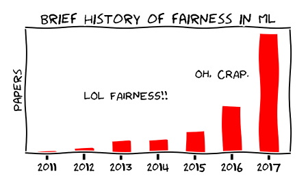
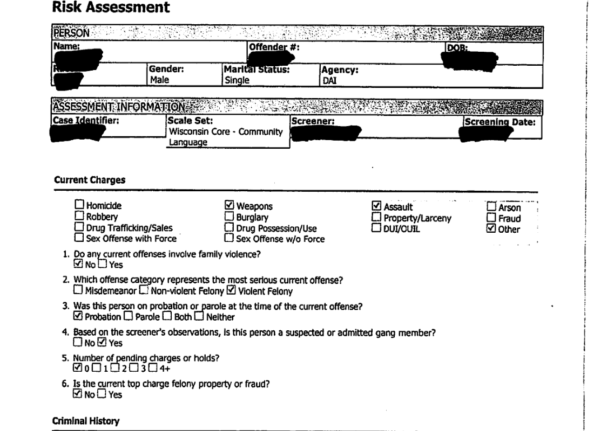
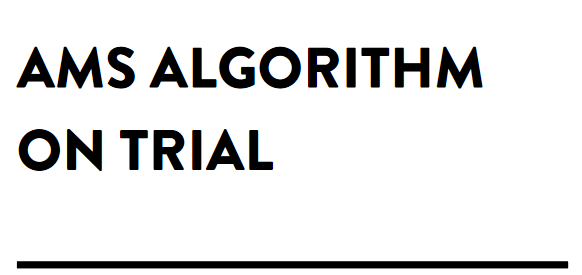
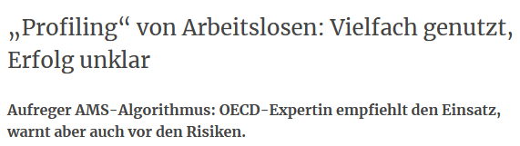
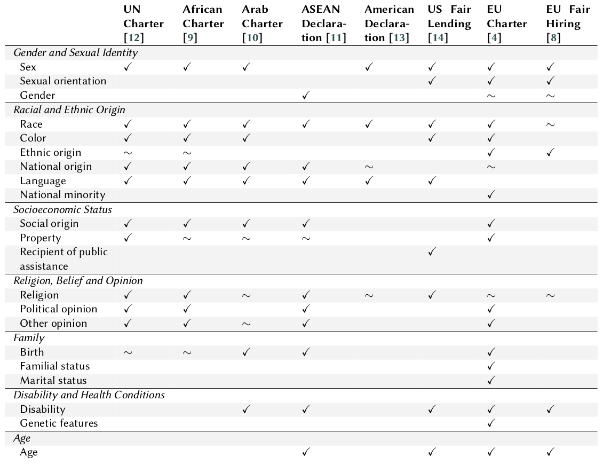
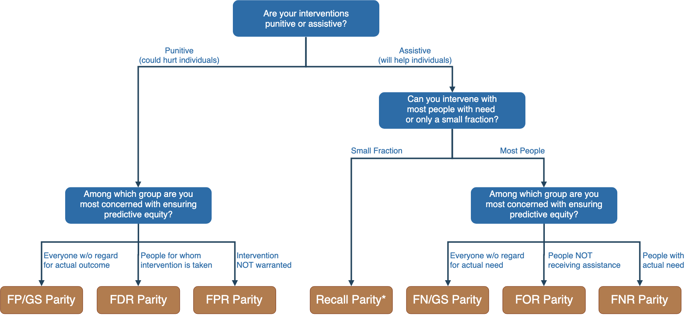
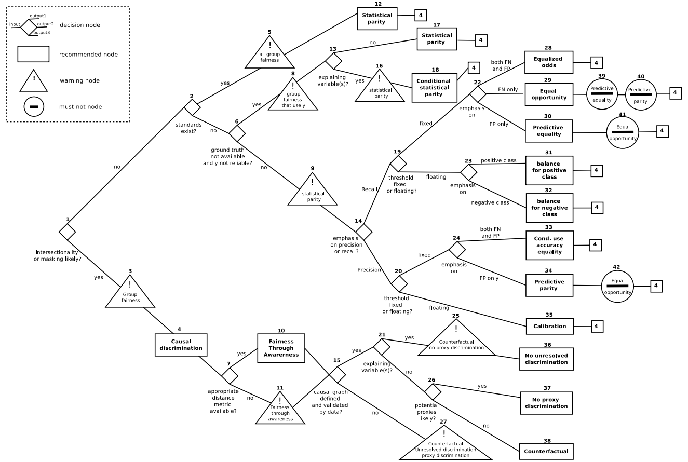
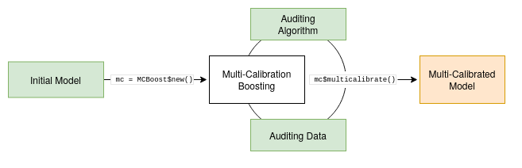

## **Foundations** of Algorithmic **Fairness** {.opening}

[Responsible AI Course: Algorithmic Fairness]{.subtitle}

{.absolute left=46 top=30 width=396 fig-alt="LMU München"}

{.absolute left=985 top=110 width=330 fig-alt="MCML"}

{.absolute left=1375 top=66 width=480 fig-alt="Universität Mannheim"}

[Christoph Kern]{.author}

[20.11.2026]{.date}

- Automated Decision-Making (ADM)
  - The COMPAS Case
- Fairness in Machine Learning
  - Bias in Data
  - (Group) Fairness Notions
     - Fairness Trade-offs
  - Individual Fairness
  - Multi-Group Fairness


# Fairness in Machine Learning?

{fig-align="center" width=60%}


# Automated Decision-Making (ADM)

> "[h]umans delegate machines to prepare decision-making or even to implement decisions" [(Algorithmwatch 2019)](https://atlas.algorithmwatch.org/datenbank/)

* ADM systems combine social & technological parts
    1. A decision-making model
    2. Algorithms that make this model applicable in the form of software code
    3. Data sets that are entered into this software, e.g. for the purpose of model training
    4. The whole of the political and economic ecosystems that ADM systems are embedded in
    - **Development**: Public or commercial
    - **Use**: With or without human deciders


# Databases on ADM systems

* Germany: [Algorithm Watch - Altas der Automatisierung: Datenbank](https://atlas.algorithmwatch.org/datenbank/) (not updated)
* United Kingdom: [Public Law Project - Tracking Automated Government (TAG) Register](https://trackautomatedgovernment.shinyapps.io/register/)
* EU: [AI-Watch](https://publications.jrc.ec.europa.eu/repository/handle/JRC120399)
* ...


# COMPAS I

Correctional Offender Management Profiling for Alternative Sanctions (COMPAS)

- Risk assessment software for rating a defendant's risk of future crime (recidivism)
    - Based on 137 features ([Questionnaire](https://www.documentcloud.org/documents/2702103-Sample-Risk-Assessment-COMPAS-CORE.html)) 
        - Does not include race!


        
- Commercial software developed by Northpointe, not publicly disclosed
- Can be used for targeting treatment programs, bail determinations, and in the course of sentencing decisions

→ Test of accuracy and racial bias by [ProPublica](https://en.wikipedia.org/wiki/ProPublica) [@Angwin2016-yh]


# COMPAS II

{fig-align="center" width=60%}


# COMPAS III

![Source: @Corbett-Davies2017-um, Fig. 1, Distribution of risk scores for Broward County^["The reason for these disparities is that white and black defendants in Broward County have different distributions of risk, $p_{Y|X}$, as shown in Figure 1. In particular, a greater fraction of black defendants have relatively high risk scores, in part because black defendants are more likely to have prior arrests, which is a strong indicator of reoffending. Importantly, while an algorithm designer can choose different decision rules based on these risk scores, the algorithm cannot alter the risk scores themselves, which reflect underlying features of the population of Broward County." [@Corbett-Davies2017-um, 803]]](figures/lecture/broward.png){fig-align="center" width=70%}


# COMPAS IV


| Metric  | Caucasian | African American  |
|---------|-----------|-------------------|
| False Positive Rate (FPR) | 23% | 45% |
| False Negative Rate (FNR) | 48% | 28% |
| False Discovery Rate (FDR) | 41% | 37% |

: COMPAS Fairness Metrics [@Rodolfa2020-se]

- ProPublica focused on FPR and FNR
- Northpointe's response^[https://go.volarisgroup.com/rs/430-MBX-989/images/ProPublica_Commentary_Final_070616.pdf] put forward FDR
- Is the model "simultaneously fair and unfair"?


# COMPAS V: Error rates {.smaller}


{fig-align="center" width=80%}


$$
\text{FPR} = \frac{\text{False Positives (FP)}}{\text{False Positives (FP)} + \text{True Negatives (TN)}}
$$


$$
\text{FNR} = \frac{\text{False Negatives (FN)}}{\text{False Negatives (FN)} + \text{True Positives (TP)}}
$$

$$
\text{FDR} = \frac{\text{False Positives (FP)}}{\text{False Positives (FP)} + \text{True Positives (TP)}}
$$

- Interpreting the rates^[The **False Positive Rate** measures the proportion of negative instances incorrectly classified as positive. **Interpretation**: For COMPAS, this reflects how often individuals who do not reoffend are incorrectly predicted to reoffend. The **False Negative Rate** measures the proportion of positive instances incorrectly classified as negative. **Interpretation**: This reflects how often individuals who will reoffend are incorrectly predicted not to reoffend. The **False Discovery Rate** measures the proportion of positive predictions that are incorrect (false positives). **Interpretation**: This reflects how often predictions of reoffending turn out to be wrong.]


# Algorithmic Profiling of Job Seekers

::: columns
::: column



:::
::: column


:::
:::

$\rightarrow$ [@achterhold2025fairness],  [@kern2024small], [@bach2023]


# Fair ML I

Fairness and Automated Decision-Making

- ML increasingly used for guiding high-stakes decisions
- Automated decision-making increases effectiveness and consistency?
    - Hope to protect against human subjectivity
- Various forms of (data) biases can be fed into the system
    - Models trained on biased data **learn to reproduce biases**!


> "In the context of decision-making, fairness is the absence of any prejudice or favoritism toward an individual or a group based on their **inherent or acquired characteristics**." [@Mehrabi2021-ft]


# Fair ML II

Definitions of discrimination in legal domains [@Barocas2016-dw]

- **Disparate Treatment**
    - Intentionally treating an individual differently based on his/her membership in a protected class 
- **Disparate Impact**
    - Negatively affecting members of a protected class more than others even if by a seemingly neutral policy


# Fair ML III

**Protected Attributes in Anti-Discrimination Legislation**

{fig-align="center" width=80%}


# Bias in Data I

- **Historical Bias**
    - *"Historical bias is the already existing bias and socio-technical issues in the world and can seep into from the data generation process even given a perfect sampling and feature selection"* [@Mehrabi2021-ft, 8]
    - Explainable discrimination: Group membership correlates with other (accepted) attributes 
    - Unexplainable discrimination: Bias after accounting for explainable differences


# Discrimination

![Effect of ethnic name on probability of invitation for job interview [@Zschirnt2016-tn]](figures/lecture/discrimination.png){width=90%}


# Bias in Data II

- **Measurement Bias**
    - *"Measurement, or reporting, bias arises from how we choose, utilize, and measure particular features"* [@Mehrabi2021-ft, 5]
    - Imperfect proxy variables that introduce historical biases 
    - Differential measurement accuracy between groups


# Measurement

![Racial differences in a range of biological measures of disease severity, conditional on algorithm
risk score [@obermeyer2019]](figures/lecture/health.png){width=90%}


# Bias in Data III

- **Representation Bias**
    - *"Representation bias arises from how we sample from a population dur- ing data collection process"* [@Mehrabi2021-ft, 5]
    - Lacking diversity in training data
- **Evaluation Bias**
    - *"Evaluation bias occurs during model iteration and evaluation"* [@Mehrabi2021-ft, 8]
    - Inappropriate test/ evaluation data
- **Population Bias/ Sampling Bias**
    - Mismatch between available training data and target population
- **Temporal Bias**
    - Differences in populations and behaviors over time
- Many more...


# Representation

![Source: @Shankar2017-tp, Fig. 3, Distribution of the geographically identifiable images in the Open Images data set, by country^[Distribution of the geographically identifiable images in the Open Images data set, by country. Almost a third of the data in our sample was US-based, and 60% of the data was from the six most represented countries across North America and Europe.]](figures/lecture/open-image.png)


# Fairness Notions: Equality of Treatment

- **Fairness through Unawareness**
  - *"An algorithm is fair as long as any protected attributes are not explicitly used in the decision-making process"*

- Blindness is ineffective! [@Dwork2012-mb]
  - Redundant Encoding: ML models can easily pick up correlates of protected attributes^[e.g., even if you remove race from the data, variables like zip code, education level, or income might still act as proxies for race.]
  - Reduced Utility: Cannot model different mechanisms across groups^[e.g., if a healthcare model ignores sex as a feature, it might fail to account for the different ways diseases manifest across men and women. This can result in a one-size-fits-all model that is less effective for all groups and fails to capture the true causal mechanisms driving the outcomes.]


# Fairness Notions: Equality of Outcomes

- **Demographic/ Statistical Parity**^[e.g., if a hiring algorithm produces an acceptance rate of 30% for both women (protected group) and men (unprotected group), the system satisfies demographic parity.]
  - *People in both protected and unprotected groups should have equal probability of being assigned to a positive outcome*

- Can be exploited by biased adversaries! [@Dwork2012-mb]
  - **Self-fulfilling prophecy**: Biased actors may assign positive outcomes to unqualified individuals in the protected group, reinforcing harmful stereotypes.
  - **Reverse tokenism**: Biased actors may deny positive outcomes to qualified individuals in the unprotected group, using this as a pretext to justify discriminatory practices.


- **Conditional Statistical Parity**
  - Demographic parity holds given a set of legitimate factors^[e.g., a hiring algorithm should ensure equal acceptance rates across genders, conditional on job-relevant qualifications like years of experience or certifications.]
  


# Fairness Notions: Equality of Errors

- Given a model, evaluation data and groups defined by protected attributes, how can we "define" fairness?


|            |          | Prediction |          |   |
|------------|----------|---------------------|-------------------|----------|
|            |          | 0                   | 1                 |          |
| **Truth** | **0**       | [**TN**]{style="color:green;"}      | [**FP**]{style="color:red;"}        | N'       |
|            | **1**       | [**FN**]{style="color:red;"}        | [**TP**]{style="color:green;"}      | P'       |
|            |          | N                   | P                 |          |


# Group Fairness

- Joint distribution of
    - Sensitive attribute $A$
    - Target variable $Y$
    - Classifier $\hat{Y}$ or score $S$

Categorizing **group fairness** notions [@Barocas2019-vk]

| Independence^[The predictions or scores should not depend on or vary with the group membership (e.g., race, gender, etc.).]  | Separation^[This means that if we already know the true label (e.g., whether someone is actually creditworthy), the predictions or scores should not vary with group membership $A$.]         | Sufficiency^[This means that if we already know the prediction, the actual true label $Y$ should not depend on group membership $A$.]         |
|-------------------------|-------------------------|-------------------------|
| $\hat{Y} \perp A$   | $\hat{Y} \perp A \mid Y$ | $Y \perp A \mid \hat{Y}$  |


# Group Fairness I

:::{.columns}
::: {.column width="50%"}

Given groups $g$ defined by protected attributes...

- **Predictive Parity**
  - Equalize $FDR_g = \frac{FP_g}{FP_g + TP_g}$^[FDR = false discovery rate; Predictive parity ensures that the proportion of false positives among all predicted positives is the same for all groups.]
- **Equal $FOR$**
  - Equalize $FOR_g = \frac{FN_g}{FN_g + TN_g}$
- **Sufficiency**^[Sufficiency ensures that the model’s predictions are equally reliable across all groups, whether considering positively predicted outcomes (via $FDR_g$) or negatively predicted outcomes (via $FOR_g$).]
  - Equalize $FDR_g$ and $FOR_g$
  
$\rightarrow$ $\sim$Perspective of decision-maker^[These metrics (predictive parity, $FOR_{g}$, and sufficiency) focus on the reliability of the model’s predictions—ensuring that decisions based on those predictions are fair for different groups. This aligns with the interests of decision-makers, who need confidence that the model does not disproportionately harm or benefit certain groups in its predictions.]


:::
::: {.column width="50%"}


|            |          | **Prediction** |          |   |
|------------|----------|---------------------|-------------------|----------|
|            |          | 0                   | 1                 |          |
| Truth | **0**       | [**TN**]{style="color:green;"}      | [**FP**]{style="color:red;"}        | N'       |
|            | **1**       | [**FN**]{style="color:red;"}        | [**TP**]{style="color:green;"}      | P'       |
|            |          | N                   | P                 |          |


:::
:::


# Group Fairness II


:::{.columns}
::: {.column width="50%"}


Given groups $g$ defined by protected attributes...

- **Predictive Equality**^[**Predictive equality** ensures that individuals in different groups have the same chance of being falsely labeled as "positive" when they shouldn't be. This is particularly important when a false positive leads to unnecessary burden or harm (e.g., being flagged as a potential fraudster or being falsely diagnosed with a disease).]
  - Equalize $FPR_g = \frac{FP_g}{FP_g + TN_g}$
- **Equal Opportunity**^[**Equal opportunity** ensures that individuals in different groups have the same chance of being correctly identified for a positive outcome. This is especially critical when a false negative denies someone access to beneficial outcomes (e.g., not getting a loan when qualified or missing a scholarship opportunity).]
  - Equalize $FNR_g = \frac{FN_g}{FN_g + TP_g}$
- **Equalized Odds**^[Equalized odds is a more stringent fairness criterion because it balances fairness for individuals in different groups for both types of errors.]
  - Equalize $FNR_g$ and $FPR_g$

$\rightarrow$ $\sim$Perspective of affected individual^[This focus on errors aligns with the experiences of individuals who interact with the system, making these metrics particularly relevant from the perspective of fairness for the affected.]


:::
::: {.column width="50%"}

|            |          | Prediction |          |   |
|------------|----------|---------------------|-------------------|----------|
|            |          | 0                   | 1                 |          |
| Truth | **0**       | [**TN**]{style="color:green;"}      | [**FP**]{style="color:red;"}        | N'       |
|            | **1**       | [**FN**]{style="color:red;"}        | [**TP**]{style="color:green;"}      | P'       |
|            |          | N                   | P                 |          |


:::
:::


# Group Fairness III


:::{.columns}
::: {.column width="50%"}

Given groups $g$ defined by protected attributes...

- **Overall Accuracy Equality**^[Overall accuracy equality ensures that the model performs with the same overall level of correctness for each group. For example, if a model has a 90% accuracy for one group, it should also have 90% accuracy for all other groups.]
  - Equalize accuracy: $\frac{TP_g+TN_g}{TP_g+FP_g+TN_g+FN_g}$
- **Treatment Equality**^[Treatment equality ensures that the ratio of false positives to false negatives is equal across groups. This means that one group is not unfairly burdened by more false positives while another group suffers more from false negatives.]
  - Equalize $\frac{FP_g}{FN_g}$


:::
::: {.column width="50%"}


|            |          | Prediction |          |   |
|------------|----------|---------------------|-------------------|----------|
|            |          | 0                   | 1                 |          |
| Truth | **0**       | [**TN**]{style="color:green;"}      | [**FP**]{style="color:red;"}        | N'       |
|            | **1**       | [**FN**]{style="color:red;"}        | [**TP**]{style="color:green;"}      | P'       |
|            |          | N                   | P                 |          |


:::
:::


# Fairness Trade-offs: Impossibility of Fairness

- *"When the base rates differ by protected group and when there is not separation, one cannot have both conditional use accuracy equality and equality in the false negative and false positive rates"* [@Berk2021-zt, 20]
  - Equality of $FDR$, $FOR$ and $FNR$, $FPR$ across groups hardly possible in practice
  - Trade-off between Sufficiency and Equalized Odds
  


# Choosing Fairness Metrics I




# Choosing Fairness Metrics II

{fig-align="center" width=80%}


# Limitations of Group Fairness

1. Group-based fairness notions can be odds with each other and with overall utility
2. **Which groups** should be considered?
   - Focus on a fixed and limited set of protected groups?
3. What about **intersections of attributes**?
   - Group-based fairness notions can be tricked
   - Protecting two groups separately can (still) concentrate positive outcomes in subgroups


# Beyond Group Fairness

1. **Group Fairness**: Treat different groups equally
   - Weak fairness guarantees
2. **Individual Fairness**: Give similar predictions to similar individuals
3. **Multi-group Fairness**: Extend group fairness to large collections of subgroups


# Fairness Through Awareness 

[@Dwork2012-mb]

For a set of individuals $V$ and a set of outcomes $A$, a mapping $M: V \rightarrow \delta(A)$ from individuals to probability distributions over outcomes satisfies the $(D, d)$-Lipschitz property if for every (pair of individuals) $x, y \in V$, we have

$$ D(Mx, My) \leq d(x, y) $$

- Distance between distributions of outputs $D$
- Distance metric between individuals $d$
- Difference in outputs should be at most distance in attributes 


# Counterfactual Fairness 

[@Kusner2017-ea]

Assume a casual model, with a set of latent background variables $U$. Predictor $\hat{Y}$ is counterfactually fair if under any context $X=x$ and $A=a$
$$ P(\hat{Y}_{A \leftarrow a}(U) = y \mid X = x, A = a) = P(\hat{Y}_{A \leftarrow a^\prime}(U) = y \mid X = x, A = a) $$
for all $y$ and for any value $a^\prime$ attainable by $A$.

- Probability of the outcome is the same in both the actual world ($A \leftarrow a$) and the counterfactual world ($A \leftarrow a^\prime$) in which protected attribute had been the opposing class
- Given a causal graph, a predictor $\hat{Y}$ is counterfactually fair if it is a function of non-descendants of the sensitive variable $A$


# Multi-Calibration

[@hebert2018multicalibration]

Require calibrated predictions for all computationally-identifiable subpopulations:

A predictor $x$ is $\alpha$-multicalibrated with respect to a family of sets $C$ if it is $\alpha$-calibrated with respect to every $S \in C$.

- Subpopulations in $C$ can be overlapping, with complex relationships
- Protect any group that can be efficiently identified, not only defined by sensitive properties
- Implementation: Iteratively update an initial predictor on subsets that violate calibration


# Multi-Accuracy

[@kim2019multiaccuracy]

For a collection of nonnegative functions $\mathcal{H} \subseteq \{h: \mathcal{X} \rightarrow \mathbb{R}^+\}$, a predictor $\tilde{\rho}: \mathcal{X} \rightarrow [0,1]$ is $(\mathcal{H}, \alpha)$-\textbf{multi-accurate} if for all $h \in \mathcal{H}$

$$ \Bigl| \textbf{E} \left[h(X) \cdot (Y - \tilde{\rho}(X))\right] \Bigr| \leq \alpha $$.

- In practice, $\mathcal{H}$ is a \textit{learnable} class of functions
- E.g., width-4 conjunctions 
- $\rightarrow$ Multi-Accuracy requires unbiasedness for all subpopulations defined by intersections of four attributes


# Multi-Calibration Boosting

**Given:**

- A set of initial predictions
- Validation data $D$
- An auditor to search for functions $h$
   - find largest residuals
   - e.g. tree, ridge regression
   
**Repeat:**

- Search over $h \in \mathcal{H}$
- If $$ |\textbf{E}_{x\sim D}[h(x) \cdot (y(x)-\tilde{\rho}(x))]| > \varepsilon  $$
   - update as $\tilde{\rho}(x) \leftarrow \tilde{\rho}(x) - \eta \cdot h(x)$


# Multi-Calibration Boosting for R

[R package mcboost [@pfisterer2021mcboost]](https://github.com/mlr-org/mcboost){fig-align="center" width=80%}




# Resources

- R: [mlr3fairness](https://mlr3fairness.mlr-org.com/)
- Python: [aif360](https://ai-fairness-360.org/)
   - Code Example: [Algorithmic Profiling](https://tinyurl.com/fair-ml-goethe)
- FairML Datasets: [FairGround](https://reliable-ai.github.io/fairground/docs/) 


# Lab R: MCBoost - Application Example


```{r setup, message = FALSE}
library(tidyverse)
library(PracTools)
library(ranger)
library(neuralnet)
library(formattable)
library(mlr3)
library(mlr3learners)
library(mlr3fairness)
library(mcboost)
```


## Data and Setup

This lab session presents two typical use cases of MCBoost with data from a health survey. The goal is to post-process two initial prediction models for multi-accuracy using different flavors of MCBoost, and to eventually compare the naive and post-processed predictors overall and for subpopulations. 

We use data derived from the National Health Interview Survey (NHIS 2003), which includes demographic and health-related variables for 21,588 individuals. This data can directly be included from the `PracTools` package.

```{r 10-fairness-1}
#| eval: true
#| echo: true
data(nhis.large)
#?nhis.large
```

In the following, our outcome of interest is whether an individual is covered by any type of health insurance (`notcov`, 1 = not covered, 0 = covered). We additionally prepare two sets of variables:

- Predictor variables (age, parents in household, education, income, employment status, physical or other limitations)
- Subpopulation variables (sex, hispanic ethnicity, race)

The second set of variables will not be used for training the initial prediction models, but will be our focus when it comes to evaluating prediction performance for subgroups.

Before we training an initial model, we preprocess the data.`

```{r 10-fairness-2}
#| eval: true
#| echo: true
categorical <- c("age.grp", "parents", "educ", "inc.grp", "doing.lw",
  "limited", "sex", "hisp", "race")

nhis <- nhis.large %>%
  mutate_at(categorical, as.factor) %>%
  mutate_at(categorical, fct_explicit_na) %>%
  drop_na(notcov) %>%
  select(all_of(categorical), notcov, svywt, ID)

nhis$notcov <- factor(ifelse(nhis$notcov == 1, "notcov", "cov"))

nhis_enc <- data.frame(model.matrix(notcov ~ ., data = nhis)[,-1])
nhis_enc$notcov <- nhis$notcov
nhis_enc$sex <- nhis$sex
nhis_enc$hisp <- nhis$hisp
nhis_enc$race <- nhis$race
nhis_enc$inv_wt <- (1 / nhis$svywt)
```

The pre-processed NHIS data will be split into three datasets:

- A training set `train` for training the initial prediction models (55 \% of data)
- An auditing set `post` for post-processing the initial models with MCBoost (20 \%)
- A test set `test`for model evaluation (25 \%)

To increase the difficulty of the prediction task, we sample from the NHIS data such that the prevalence of demographic subgroups in the test data differs from their prevalence in the training and auditing data. This is achieved by employing weighted sampling from NHIS (variable `inv_wt` from above).

```{r 10-fairness-3}
#| eval: true
#| echo: true
set.seed(2953)

test <- nhis_enc %>% slice_sample(prop = 0.25, weight_by = inv_wt)

nontest_g <- nhis_enc %>% anti_join(test, by = "ID")

train_g <- nontest_g %>% slice_sample(prop = 0.75)

post <- nontest_g %>% anti_join(train_g, by = "ID") %>% select(-ID, -svywt, -inv_wt, -c(sex:race))

train <- train_g %>% select(-ID, -svywt, -inv_wt, -c(sex:race), -c(sex2:race3))
```

As a result, non-hispanic white individuals (`hisp2`) are overrepresented and hispanic individuals are underrepresented in both the training and auditing set, compared to their prevalence in the test set.

```{r 10-fairness-4}
#| eval: true
#| echo: true
train_g %>% summarise_at(vars(sex2:race3), mean)
# hispanic individuals
1 - sum(train_g %>% summarise_at(vars(hisp2:hisp4), mean))
```

```{r 10-fairness-5}
#| eval: true
#| echo: true
post %>% summarise_at(vars(sex2:race3), mean)
# hispanic individuals
1 - sum(post %>% summarise_at(vars(hisp2:hisp4), mean))
```

```{r 10-fairness-6}
#| eval: true
#| echo: true
test %>% summarise_at(vars(sex2:race3), mean)
# hispanic individuals
1 - sum(test %>% summarise_at(vars(hisp2:hisp4), mean))
```

## Fairness Metrics

We train a random forest with the default settings of the ranger package as the initial predictor.

```{r 10-fairness-7}
#| eval: true
#| echo: true
rf <- ranger(notcov ~ ., data = train)
```

Predict on test set and select fairness metrics. See <https://mlr3fairness.mlr-org.com/articles/measures-vignette.html> for an overview.

```{r 10-fairness-8}
#| eval: true
#| echo: true
rf_pred <- as.factor(predict(rf, test)$prediction)
metrics <- msrs(c("fairness.cv", "fairness.acc", "fairness.fnr", "fairness.fpr", "fairness.eod"))
```

Compute metrics on the test set.

```{r 10-fairness-9}
#| eval: true
#| echo: true
compute_metrics(
  data = test, 
  target = "notcov",
  prediction = rf_pred,
  protected_attribute = "sex2",
  metrics = metrics
)
```

## Improve Subgroup Calibration

Next, we post-process the random forest with MCBoost.

```{r 10-fairness-10}
#| eval: false
#| echo: true
rf <- ranger(notcov ~ ., data = train, probability = TRUE)
```

### MCBoost Auditing

We first prepare a function to pass the predictions to MCBoost for post-processing.

```{r 10-fairness-11}
#| eval: false
#| echo: true
init_rf = function(data) {
  predict(rf, data)$prediction[, 2]
}
```

To showcase different use cases of MCBoost, we prepare two post-processing data sets based on the auditing set. The first set includes only the predictor variables that were used by the initial models, whereas the second set will allow post-processing based on our demographic subgroups of interest (sex, hispanic ethnicity, race).

```{r 10-fairness-12}
#| eval: false
#| echo: true
d1 <- select(post, -c(notcov, sex2:race3))
d2 <- select(post, -notcov)
l <- 1 - one_hot(post$notcov)
```

We use two custom auditors for MCBoost, i.e., ridge and lasso regression with different penalties on model complexity.

```{r 10-fairness-13}
#| eval: false
#| echo: true
ridge = LearnerAuditorFitter$new(lrn("regr.glmnet", 
                                     alpha = 0, 
                                     lambda = 2 / nrow(post)))

lasso = LearnerAuditorFitter$new(lrn("regr.glmnet", 
                                     alpha = 1, 
                                     lambda = 40 / nrow(post)))
```

The ridge regression will only be given access to the initial predictor variables when post-processing the random forest predictions. In contrast, we allow the lasso regression to audit the initial predictions both with the initial predictors and the subpopulations (sex, hispanic ethnicity, race). In summary, we have:

- `rf`: Initial random forest
- `rf_mc_ridge`: Random forest, post-processed with ridge regression and the initial set of predictor variables
- `rf_mc_lasso`: Random forest, post-processed with lasso regression and the extended set of predictors

```{r 10-fairness-14}
#| eval: false
#| echo: true
rf_mc_ridge = MCBoost$new(init_predictor = init_rf,
                          auditor_fitter = ridge,
                          multiplicative = TRUE,
                          partition = TRUE,
                          max_iter = 20)
rf_mc_ridge$multicalibrate(d1, l)

rf_mc_lasso = MCBoost$new(init_predictor = init_rf,
                          auditor_fitter = lasso,
                          multiplicative = TRUE,
                          partition = TRUE,
                          max_iter = 20)
rf_mc_lasso$multicalibrate(d2, l)
```

### Model Evaluation

We compute predicted probabilities and class predictions using the initial and post-processed models.

```{r 10-fairness-15}
#| eval: false
#| echo: true
test$rf <- predict(rf, test)$prediction[, 2]
test$rf_mc_ridge <- rf_mc_ridge$predict_probs(test)
test$rf_mc_lasso <- rf_mc_lasso$predict_probs(test)

test$c_rf <- round(test$rf)
test$c_rf_mc_ridge <- round(test$rf_mc_ridge)
test$c_rf_mc_lasso <- round(test$rf_mc_lasso)
test$label <- 1 - one_hot(test$notcov)
```

Here we compare the overall accuracy of the initial and post-processed models.

```{r 10-fairness-16}
#| eval: false
#| echo: true
mean(test$c_rf == test$label)
mean(test$c_rf_mc_ridge == test$label)
mean(test$c_rf_mc_lasso == test$label)
```

However, we might be concerned with calibration in subpopulations. In the following we focus on subgroups defined by 2-way conjunctions of sex, hispanic ethnicity, and race.

```{r 10-fairness-17}
#| eval: false
#| echo: true
test <- test %>%
  group_by(sex, hisp) %>%
  mutate(sex_hisp = cur_group_id()) %>%
  group_by(sex, race) %>%
  mutate(sex_race = cur_group_id()) %>%
  group_by(hisp, race) %>%
  mutate(hisp_race = cur_group_id()) %>%
  ungroup()

grouping_vars <- c("sex", "hisp", "race", "sex_hisp", 
                   "sex_race", "hisp_race")

eval <- map(grouping_vars, group_by_at, .tbl = test) %>%
  map(summarise,
      'bias_rf' = abs(mean(rf) - mean(label))*100,
      'bias_rf_mc_ridge' = abs(mean(rf_mc_ridge) - mean(label))*100,
      'bias_rf_mc_lasso' = abs(mean(rf_mc_lasso) - mean(label))*100,
      'size' = n()) %>%
  bind_rows()
```

This evaluation focuses on the difference between the average predicted risk of healthcare non-coverage and the observed proportion of non-coverage in the test data for subgroups. Considering the MCBoost-Ridge (`rf_mc_ridge`) and MCBoost-Lasso (`rf_mc_lasso`) results, post-processing with MCBoost reduces bias for many subpopulations.

```{r 10-fairness-18}
#| eval: false
#| echo: true
eval %>%
  arrange(desc(size)) %>%
  select(size, bias_rf:bias_rf_mc_lasso) %>%
  round(., digits = 3) %>%
  formattable(., lapply(1:nrow(eval), function(row) {
  area(row, col = 2:4) ~ color_tile("lightgreen", "transparent")
    }))
```

## Improve Subgroup Accuracy

We train an initial model for predicting healthcare coverage with the training set. Here, we use a neural network with one hidden layer, rather naively with little tweaking.

```{r 10-fairness-19, message = FALSE}
#| eval: false
#| echo: true
nnet <- neuralnet(notcov ~ .,
  hidden = 5,
  linear.output = FALSE,
  err.fct = 'ce',
  threshold = 0.5,
  lifesign = 'full',
  data = train
)
```

### MCBoost Auditing

We prepare a function that allows us to pass the predictions of the model to MCBoost for post-processing.

```{r 10-fairness-20}
#| eval: false
#| echo: true
init_nnet = function(data) {
  predict(nnet, data)[, 2]
}
```

We initialize two custom auditors for MCBoost: Ridge regression with a small penalty on model complexity, and a `SubpopAuditorFitter` with a fixed set of subpopulations.

```{r 10-fairness-21}
#| eval: false
#| echo: true
ridge = LearnerAuditorFitter$new(lrn("regr.glmnet", 
                                     alpha = 0, 
                                     lambda = 2 / nrow(post)))

pops = SubpopAuditorFitter$new(list("sex2", "hisp2", "hisp3", 
                                    "hisp4", "race2", "race3"))
```

The ridge regression will only be given access to the initial predictor variables when post-processing the neural net predictions with the auditing data. In contrast, we guide the subpop-fitter to audit the initial predictions explicitly on the outlined subpopulations (sex, hispanic ethnicity, race). In summary, we have:

- `nnet`: Initial neural net
- `nnet_mc_ridge`: Neural net, post-processed with ridge regression and the initial set of predictor variables
- `nnet_mc_subpop`: Neural net, post-processed with a fixed set of subpopulations

```{r 10-fairness-22}
#| eval: false
#| echo: true
nnet_mc_ridge = MCBoost$new(init_predictor = init_nnet,
                            auditor_fitter = ridge,
                            multiplicative = TRUE,
                            partition = TRUE,
                            max_iter = 15)
nnet_mc_ridge$multicalibrate(d1, l)

nnet_mc_subpop = MCBoost$new(init_predictor = init_nnet,
                             auditor_fitter = pops,
                             partition = TRUE,
                             max_iter = 15)
nnet_mc_subpop$multicalibrate(d2, l)
```

### Model Evaluation

Next, we use the initial and post-processed models to predict the outcome in the test data. We compute predicted probabilities and class predictions.

```{r 10-fairness-23}
#| eval: false
#| echo: true
test$nnet <- predict(nnet, newdata = test)[, 2]
test$nnet_mc_ridge <- nnet_mc_ridge$predict_probs(test)
test$nnet_mc_subpop <- nnet_mc_subpop$predict_probs(test)

test$c_nnet <- round(test$nnet)
test$c_nnet_mc_ridge <- round(test$nnet_mc_ridge)
test$c_nnet_mc_subpop <- round(test$nnet_mc_subpop)
test$label <- 1 - one_hot(test$notcov)
```

Here we compare the overall accuracy of the initial and post-processed models. Overall, we observe little differences in performance.

```{r 10-fairness-24}
#| eval: false
#| echo: true
mean(test$c_nnet == test$label)
mean(test$c_nnet_mc_ridge == test$label)
mean(test$c_nnet_mc_subpop == test$label)
```

However, we might be concerned with model performance for smaller subpopulations. In the following, we focus on subgroups defined by 2-way conjunctions of sex, hispanic ethnicity, and race.

```{r 10-fairness-25, warning = FALSE}
#| eval: false
#| echo: true
test <- test %>%
  group_by(sex, hisp) %>%
  mutate(sex_hisp = cur_group_id()) %>%
  group_by(sex, race) %>%
  mutate(sex_race = cur_group_id()) %>%
  group_by(hisp, race) %>%
  mutate(hisp_race = cur_group_id()) %>%
  ungroup()

grouping_vars <- c("sex", "hisp", "race", "sex_hisp", 
                   "sex_race", "hisp_race")

eval <- map(grouping_vars, group_by_at, .tbl = test) %>%
  map(summarise,
      'accuracy_nnet' = mean(c_nnet == label),
      'accuracy_nnet_mc_ridge' = mean(c_nnet_mc_ridge == label),
      'accuracy_nnet_mc_subpop' = mean(c_nnet_mc_subpop == label),
      'size' = n()) %>%
  bind_rows()
```

We evaluate classification accuracy on these subpopulations, and order the results according to the size of the selected subgroups (`size`). Subgroup accuracy varies between methods, with MCBoost-Ridge (`nnet_mc_ridge`) and MCBoost-Subpop (`nnet_mc_subpop`) stabilizing subgroup performance when compared to the initial model, respectively.

```{r 10-fairness-26}
#| eval: false
#| echo: true
eval %>%
  arrange(desc(size)) %>%
  select(size, accuracy_nnet:accuracy_nnet_mc_subpop) %>%
  round(., digits = 3) %>%
  formattable(., lapply(1:nrow(eval), function(row) {
  area(row, col = 2:4) ~ color_tile("transparent", "lightgreen")
    }))
```


# References


