## **Research Findings** and How They May Inform **Practice** {.opening}

{.absolute left=31 top=20 width=264 fig-alt="LMU München"}

{.absolute left=657 top=73 width=220 fig-alt="MCML"}

{.absolute left=917 top=44 width=320 fig-alt="Universität Mannheim"}

[Jan Simson]{.author}

[20.11.2026]{.date}

::: {.pipeline .bare}
:::

# [**Intro —**]{.kicker} The Machine Learning Pipeline {#intro .section-slide}

::: {.notes}
Getting a good and fair model needs this pipeline
:::

## The Machine Learning Pipeline

- Several high-level frameworks exist for "*Data Science Life Cycle*"
  - e.g., CRISP-DM [[@chapman2000crispdm]]{.cite}, PCS Framework [[@yu2020veridical; @yu2024veridical]]{.cite}

. . .

- No comprehensive frameworks for the "ML Pipeline"
  - Clearest specifications often in AutoML
  - Technical implementations of pipelines in libraries [[@pedregosa2011scikitlearn; @binder2021mlr3pipelines]]{.cite}
  - High variety of ML pipelines [[@xin2021production]]{.cite}
  - At least partially dataset-specific [[@zoller2021benchmark]]{.cite}

## The Machine Learning Pipeline {auto-animate=true}

::: {.pipeline .simple}
:::

[Not quite that simple]{.tape .fragment}

## The Machine Learning Pipeline {auto-animate=true}

::: {.pipeline .large icons=true}
:::

[Simplified illustration, drawing on [@zoller2021benchmark]{.cite} and [@simson2024one]{.cite}]{.footer-note}

::: {.notes}
There's more, both in depth i.e. you could zoom in and outside of this e.g. data sourcing and deployment.
:::

## Should we Re-Evaluate this Pipeline? {auto-animate=true}

::: {.pipeline .large icons=true}
:::

[Simplified illustration, drawing on [@zoller2021benchmark]{.cite} and [@simson2024one]{.cite}]{.footer-note}

::: {.notes}
Should we re-evaluate this pipeline and if so – how?
:::

## Contributions {auto-animate=true}

::: {.contrib-list}
- Lazy Data Practices
- Multiverse Analysis for Algorithmic Fairness
- Participatory Multiverse
:::

::: {.papers}
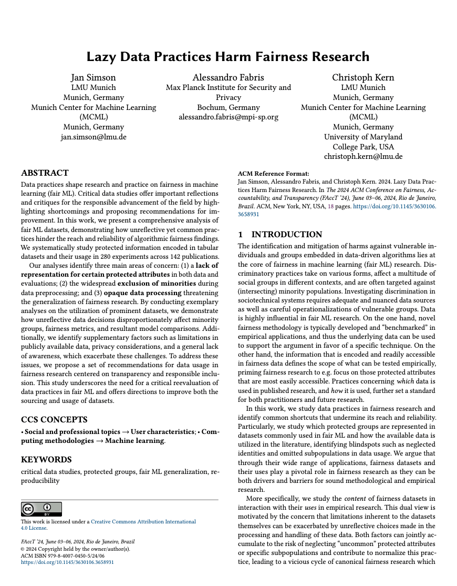{.absolute left=922 top=124 fig-alt="Paper: Lazy Data Practices Harm Fairness Research"}
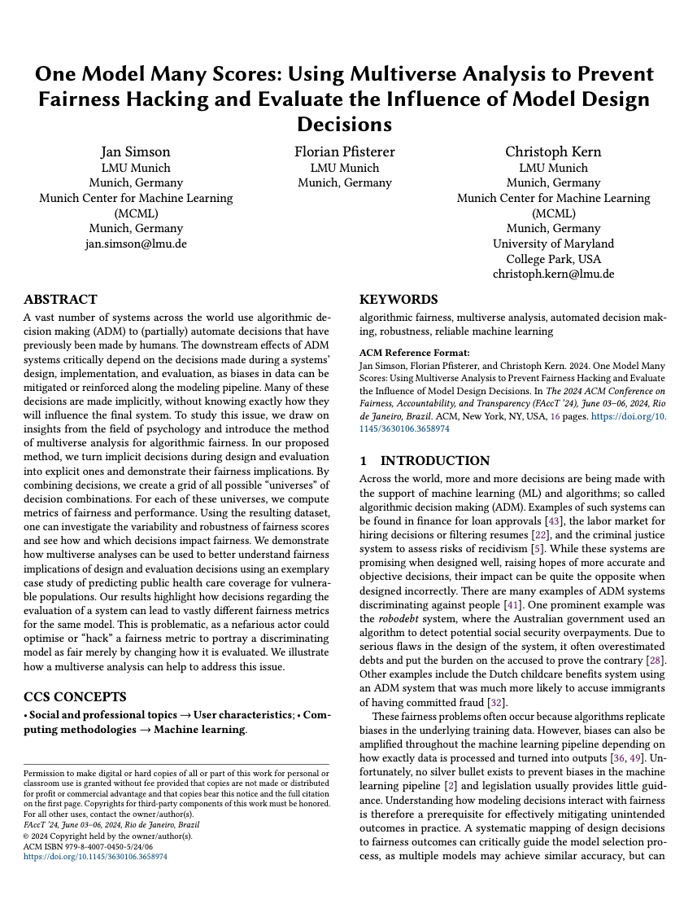{.absolute left=957 top=163 fig-alt="Paper: One Model Many Scores"}
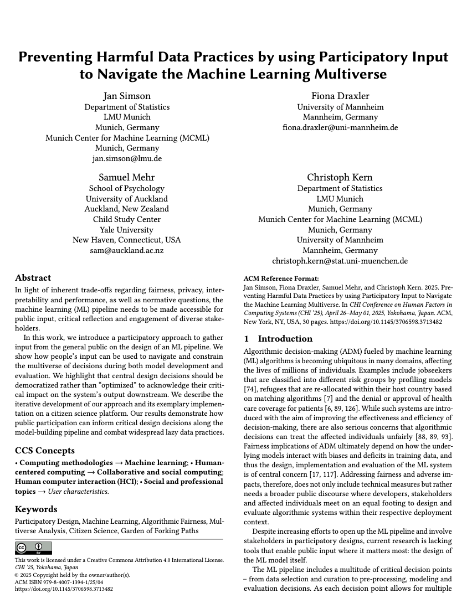{.absolute left=1008 top=209 fig-alt="Paper: Participatory Multiverse"}
:::

::: {.pipeline nodes="r p b b b b"}
:::

# [**Contribution —**]{.kicker} Lazy Data Practices Harm Fairness Research {#lazy-data-practices .contribution auto-animate=true}

::: {.faces}
{.absolute left=94 top=215 fig-alt="Coauthor portrait"}
{.absolute left=217 top=215 fig-alt="Coauthor portrait"}
:::

{.absolute left=1048 top=67 width=174 fig-alt="FAccT logo"}

::: {.byline}
**Jan Simson**, Alessandro Fabris, Christoph Kern

[Proceedings of the 2024 ACM Conference on Fairness, Accountability, and Transparency, FAccT '24 https://doi.org/10.1145/3630106.3658931]{.venue}
:::

::: {.pipeline .compact nodes="r r k k k k"}
:::

## How are Datasets used in FairML?

- Build on systematic review of literature [[@fabris2022algorithmic]]{.cite}
  - Papers at major ML and FairML conferences matching fairness related keywords
  - Focus on fair classification and tabular datasets

. . .

[***N* = 142 publications**   //   ***N* = 280 experiments**]{.stat}

. . .

- Annotate how datasets are *used*
  - Protected Attributes, Target, Features
  - Processing
  - Enough Information?

## Lazy Practice #1: **Neglected Identities**

- Noticed many publications focusing on the same narrow set of protected / sensitive attributes

. . .

- Compare with a list of protected attributes (*non-exhaustive*)
  - From human rights treaties & anti-discrimination laws: [UN Charter, African Charter, Arab Charter, ASEAN Declaration, European Charter, American Declaration, US Fair Lending, EU Fair Hiring]{.cite}

## Protected Attributes in Different Legislations {.side-title}

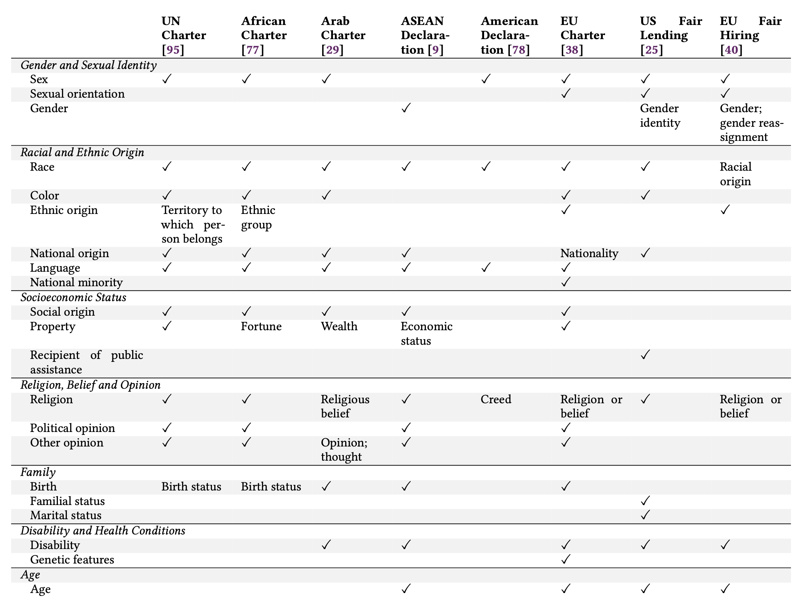{.absolute left=332 top=30 width=857 fig-alt="Protected attributes across human-rights treaties and anti-discrimination laws"}

[✔️: Literal phrasing matches row header, raw text otherwise]{.absolute .small left=49 top=330 width=260}

## [Lazy Practice #1]{.kicker} **Neglected Identities** {.corner-title auto-animate=true}

::: {.stage}
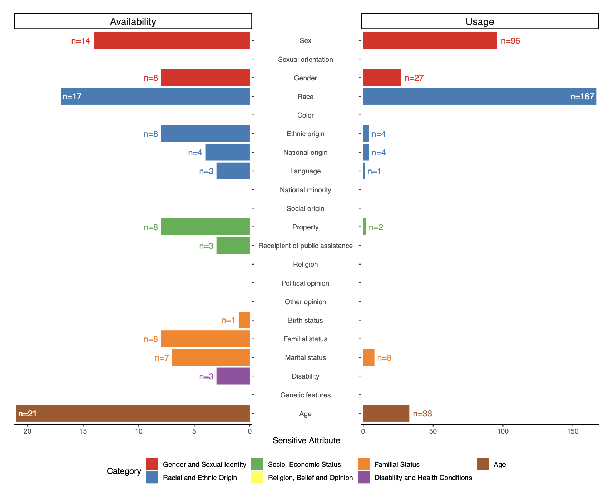{.absolute data-id="attr-chart" left=147 top=8 width=990 style="clip-path:inset(6.29% 41.822% 11.831% 41.466%);" fig-alt="Protected attributes: labels only"}
[Protected Attribute]{.absolute .lbl .small data-id="attr-head" left=553 top=26 width=174}
:::

::: {.notes}
21 attributes

Race and religion across all of them
:::

## [Lazy Practice #1]{.kicker} **Neglected Identities** {.corner-title auto-animate=true}

::: {.stage}
{.absolute data-id="attr-chart" left=147 top=8 width=990 style="clip-path:inset(6.289% 41.822% 12.223% 0.682%);" fig-alt="Protected attributes: availability in datasets"}
[Protected Attribute]{.absolute .lbl .small data-id="attr-head" left=553 top=26 width=174}
[**Availability** (in Datasets) *N* = 36]{.absolute .lbl data-id="attr-avail" left=32 top=317 width=225}
:::

## [Lazy Practice #1]{.kicker} **Neglected Identities** {.corner-title auto-animate=true}

::: {.stage}
{.absolute data-id="attr-chart" left=147 top=8 width=990 style="clip-path:inset(6.289% 2.03% 12.223% 0.683%);" fig-alt="Protected attributes: availability in datasets and usage in literature"}
[Protected Attribute]{.absolute .lbl .small data-id="attr-head" left=553 top=26 width=174}
[**Availability** (in Datasets) *N* = 36]{.absolute .lbl .muted data-id="attr-avail" left=32 top=317 width=225}
[**Usage** (in Literature) *N* = 233]{.absolute .lbl data-id="attr-usage" left=1014 top=317 width=235}
:::

::: {.notes}
Literature, number of experiments (with sufficient information)
:::

## Lazy Practice #2: **Omitted Populations**

::: {.narrow style="--w:470px"}
- Populations are frequently omitted in preprocessing

::: {.fragment fragment-index=1}
- Annotated processing of *race* for *N* = 69 articles using COMPAS [[@angwin2016machine]]{.cite}
:::

::: {.fragment fragment-index=2}
- Most publications (**89.8%**) reduced the data to just two groups
:::

::: {.fragment fragment-index=3}
- **None** of the strategies keep Asians or Native Americans as distinct groups
:::
:::

::: {.fragment fragment-index=2}
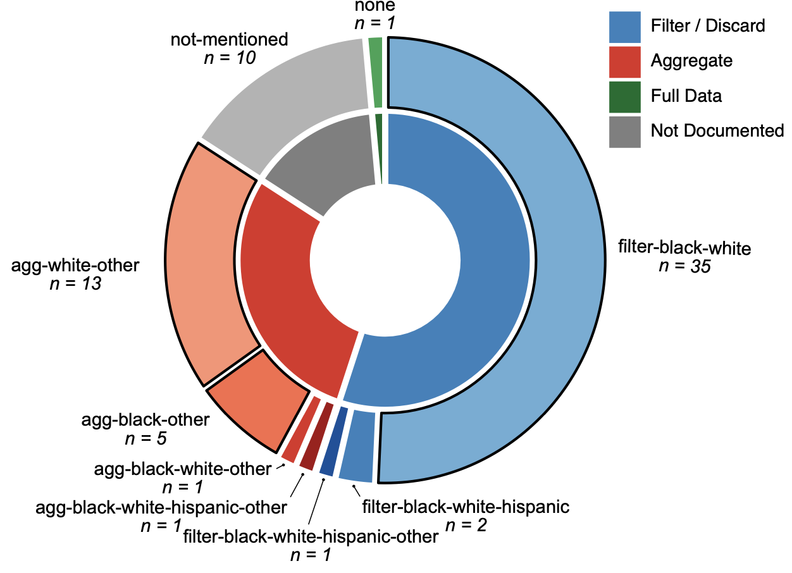{.absolute left=555 top=171 width=717 fig-alt="Handling of protected groups in COMPAS articles"}
[**Handling of protected groups**]{.absolute .small left=1097 top=129}
:::

::: {.notes}
Guide: filter (blue), aggregate (red)

90% (black borders) retain only TWO GROUPS

None keep Asians / native Americas as distinct groups around
:::

## Lazy Practice #3.1: **Opaque Preprocessing**

::: {.narrow style="--w:480px"}
- Many articles do not provide enough information to reconstruct dataset usage

::: {.fragment fragment-index=1}
- Even fewer have source code of analyses available (39%)
:::
:::

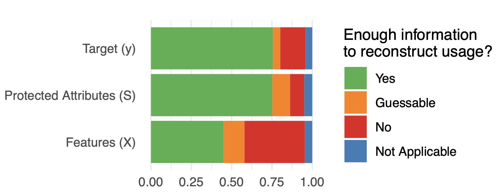{.absolute left=605 top=177 width=584 fig-alt="Enough information to reconstruct usage"}

::: {.fragment fragment-index=1}
{.absolute left=605 top=435 width=584 fig-alt="Availability of source code"}
:::

## Lazy Practice #3.2: **Opaque Preprocessing** {auto-animate=true}

::: {.narrow style="--w:450px"}
- Annotated usage for *N* = 9 articles using Bank Marketing [[@moro2014data]]{.cite} dataset
:::

::: {.stage}
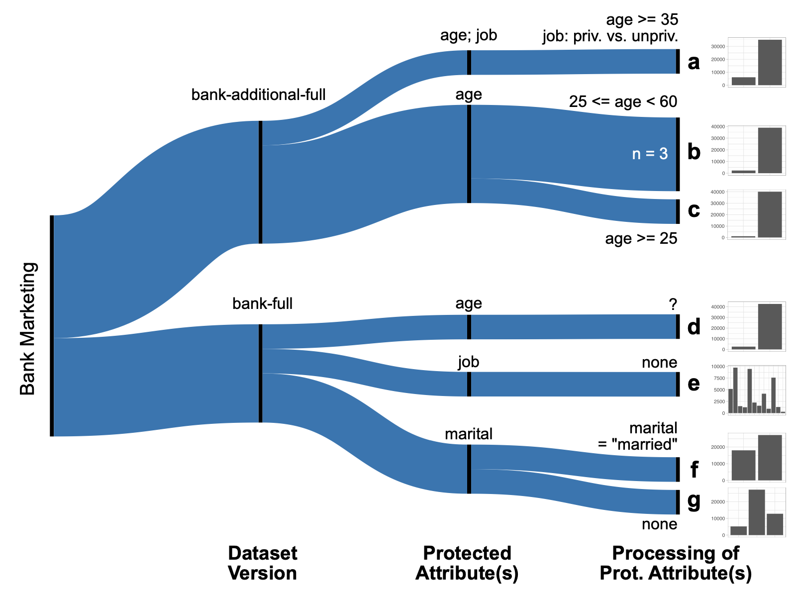{.absolute data-id="bank-chart" left=538 top=157 width=695 style="clip-path:inset(0 91.252% 0 0);" fig-alt="Bank Marketing dataset"}
:::

## Lazy Practice #3.2: **Opaque Preprocessing** {auto-animate=true}

::: {.narrow style="--w:450px"}
- Annotated usage for *N* = 9 articles using Bank Marketing [[@moro2014data]]{.cite} dataset
:::

::: {.stage}
{.absolute data-id="bank-chart" left=538 top=157 width=695 style="clip-path:inset(0 57.361% 0 0);" fig-alt="Bank Marketing dataset versions"}
:::

## Lazy Practice #3.2: **Opaque Preprocessing** {auto-animate=true}

::: {.narrow style="--w:450px"}
- Annotated usage for *N* = 9 articles using Bank Marketing [[@moro2014data]]{.cite} dataset
:::

::: {.stage}
{.absolute data-id="bank-chart" left=538 top=157 width=695 style="clip-path:inset(0 33.669% 0 0);" fig-alt="Bank Marketing dataset versions and protected attributes"}
:::

## Lazy Practice #3.2: **Opaque Preprocessing** {auto-animate=true}

::: {.narrow style="--w:450px"}
- Annotated usage for *N* = 9 articles using Bank Marketing [[@moro2014data]]{.cite} dataset
- *N* = 7 different variants of usage, all using the *"same"* dataset
  - Variants affect model choice / fairness metrics
  - Lower bound of variation (only three decisions)
:::

::: {.stage}
{.absolute data-id="bank-chart" left=538 top=157 width=695 style="clip-path:inset(0 0.271% 0 0);" fig-alt="Seven variants of using the Bank Marketing dataset"}
:::

## **Key Points**

- **Neglected Identities** in availability and usage of prot. attributes

. . .

- **Omitted Populations** during the preprocessing of data

. . .

- **Opaque Preprocessing:** High variability & lack of documentation
  - Which version of a dataset was used
  - Reproducible source code of analyses

::: {.fragment}
<svg class="overlay" viewBox="0 0 1280 720"><polygon points="716,512.5 826,512.5 826,501 872,524 826,547 826,535.5 716,535.5" transform="rotate(10 794 524)" style="fill:#fff;stroke:#000;stroke-width:2"/></svg>

{.absolute left=865 top=433 width=268 fig-alt="FairGround logo"}

[FairGround]{.absolute .lbl left=923 top=655 width=177}
:::

::: {.notes}
These are hard (!) and some may require also changes on the reviewer side, but worthwhile for us as a field to improve.
:::

## → We examined the effect of only three small processing decisions, what happens if we look at more? {.section-slide}

# [**Contribution —**]{.kicker} One Model Many Scores: Using Multiverse Analysis to Prevent Fairness Hacking and Evaluate the Influence of Model Design Decisions {#one-model-many-scores .contribution auto-animate=true}

::: {.faces}
{.absolute left=87 top=102 fig-alt="Coauthor portrait"}
{.absolute left=211 top=102 fig-alt="Coauthor portrait"}
:::

{.absolute left=1048 top=67 width=174 fig-alt="FAccT logo"}

::: {.byline}
**Jan Simson**, Florian Pfisterer, Christoph Kern

[Proceedings of the 2024 ACM Conference on Fairness, Accountability, and Transparency, FAccT '24 https://doi.org/10.1145/3630106.3658974]{.venue}
:::

::: {.pipeline .compact nodes="k b b b b b"}
:::

## The Machine Learning Pipeline {auto-animate=true}

::: {.pipeline .large icons=true forks=hide}
:::

## A Pipeline Full of Design Decisions {auto-animate=true}

::: {.pipeline .large icons=true forks=show gap=66}
:::

[Garden of forking paths [[@gelman2014statistical]]{.cite}]{.footer-note}

## In the End, We Create **Only One** Of *Many* Potential Models

::: {.narrow style="--w:660px"}
::: {.fragment}
- Explicitly combine plausible decisions to generate a *multiverse* of models
:::

::: {.fragment}
- *Multiverse Analysis:* Traverse and explore universes in the multiverse
  - From Psychology [[@steegen2016increasing]]{.cite}
:::

::: {.fragment}
- We adapt this for fairness (and ML)
  - Compute fairness metric for each *universe*
  - Demonstrate across two studies
:::
:::

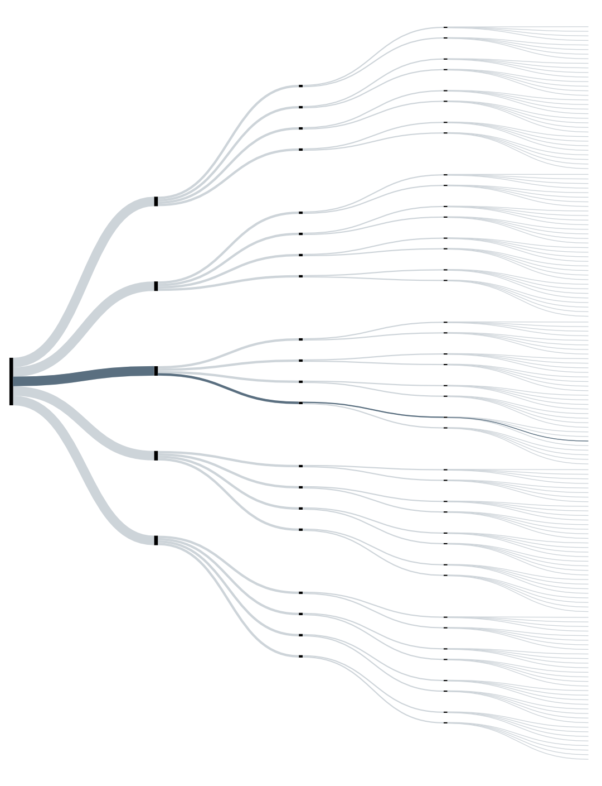{.absolute left=773 top=47 width=488 fig-alt="Branching model multiverse"}

<svg class="overlay" viewBox="0 0 1280 720"><path d="M1261 66V216M1253 205l8 12 8-12" style="stroke:#000;stroke-width:4;stroke-linecap:round;stroke-linejoin:round"/></svg>

## Case Study: Dataset

**Predict public health care coverage**

- ACSPublicCoverage in folktables [[@ding2021retiring]]{.cite}
  - Based on US Census data for state of California

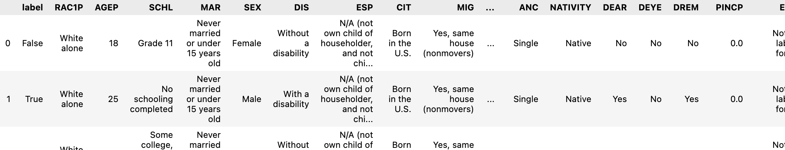{.absolute left=101 top=362 width=1179 fig-alt="ACSPublicCoverage sample rows"}

::: {.notes}
N = 138,554 rows;  p = 19 features
:::

## **Study 1:** Model Design Decisions

9 (often implicit) Decisions [→ *N* = 61,440 universes simulated]{.muted}

- **Preprocessing**
  - *Exclude Features, Exclude Subgroups*
  - *Scale, Preprocess Age, Preprocess Income, Encoding of Categoricals*
- **Model**
  - *Model Type, Stratify Split*
- **Decision**
  - *Cutoff*

::: {.pipeline nodes="k b b b b k"}
:::

::: {.notes}
Design Decisions => lead to different models

e.g. using a different model type such
:::

## **Equalized Odds Difference**

[$S$: prot. attr. $\hat{Y}$: prediction = decision $Y$: ground truth]{.absolute .small .legend left=990 top=28}

- **Separation:** Error rates should be equal across all groups $g$ of $S$
  - aka: Equalized odds, disparate mistreatment, error rate balance and more [[@pessach2022review]]{.cite}

$$
\begin{aligned}
P(\hat{Y}=1 \mid Y=1,S=g_1)&=P(\hat{Y}=1 \mid Y=1,S=g_2) &&\text{(TPR)}\\
P(\hat{Y}=1 \mid Y=0,S=g_1)&=P(\hat{Y}=1 \mid Y=0,S=g_2) &&\text{(FPR)}
\end{aligned}
$$

. . .

- **Equalized Odds Difference:** Maximum difference in *TPR* and *FPR* between different groups $g$ of $S$ [[@weerts2023fairlearn]]{.cite}
  - Lower is better; ranges from 0 to 1

## There is a Lot of Variation in the *Multiverse*

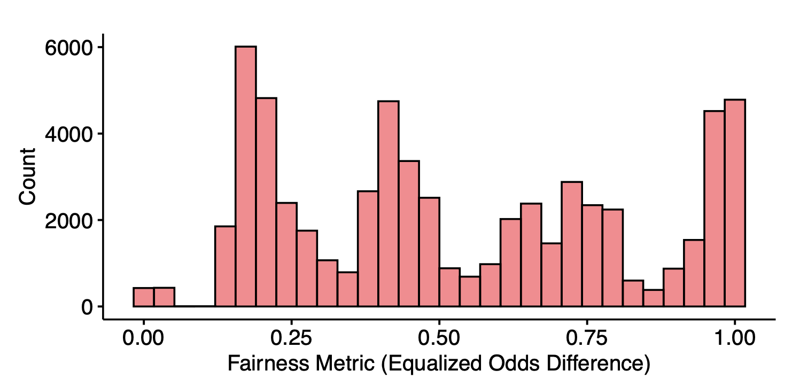{.absolute left=171 top=192 width=938 fig-alt="Distribution of equalized odds difference across the multiverse"}

[← Lower is better]{.absolute .lbl .small left=603 top=650 width=175}

## How Can we Attribute this Variation?

- We can use a functional analysis of variance (FANOVA) to decompose the variance [[@hooker2007generalized]]{.cite}
- Allows identifying the most important decisions …and their interactions → to examine them in detail

::: {.pipeline nodes="k b b b b k" sizes="1 1.4 1.85 .77 1.45 1.65"}
:::

## Identifying the Most Important Decisions

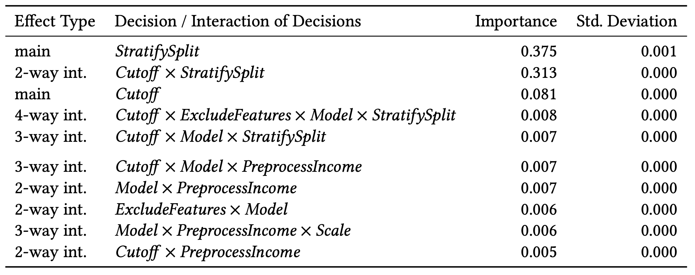{.absolute left=88 top=201 width=1104 fig-alt="FANOVA main and interaction effects ranked by importance"}

<!-- arrow tail starts far off-slide so it bleeds to the screen edge -->
<svg class="overlay marker" viewBox="0 0 1280 720"><polygon class="fragment" points="-2000,295 61,295 61,273 105,317 61,361 61,339 -2000,339" style="stroke:#c00000;stroke-width:6"/></svg>

::: {.notes}
N = 511 main and interaction effects
:::

## Examining Decisions in Detail

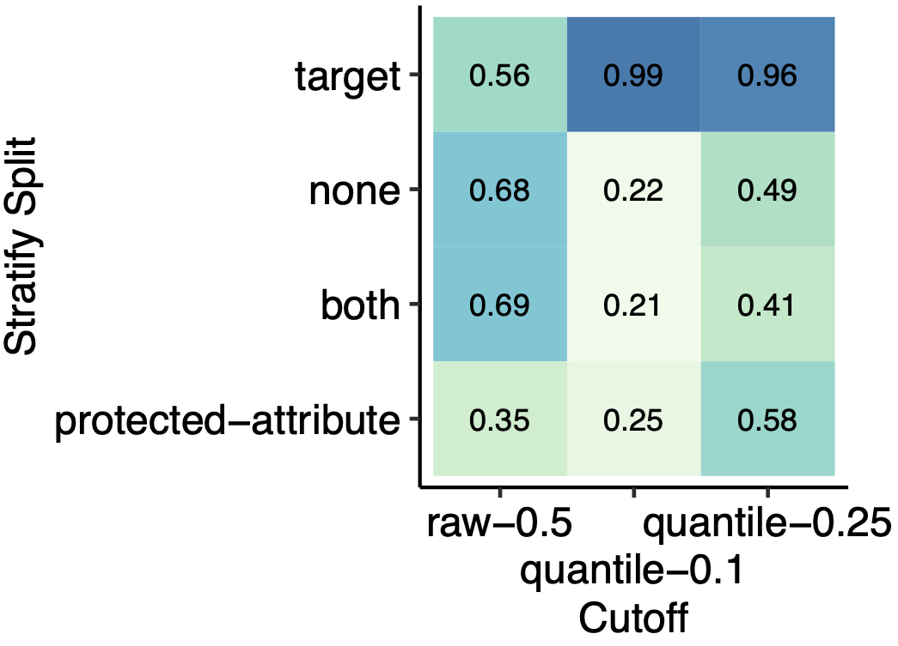{.absolute left=99 top=178 width=733 fig-alt="Fairness heatmap by cutoff and stratification"}

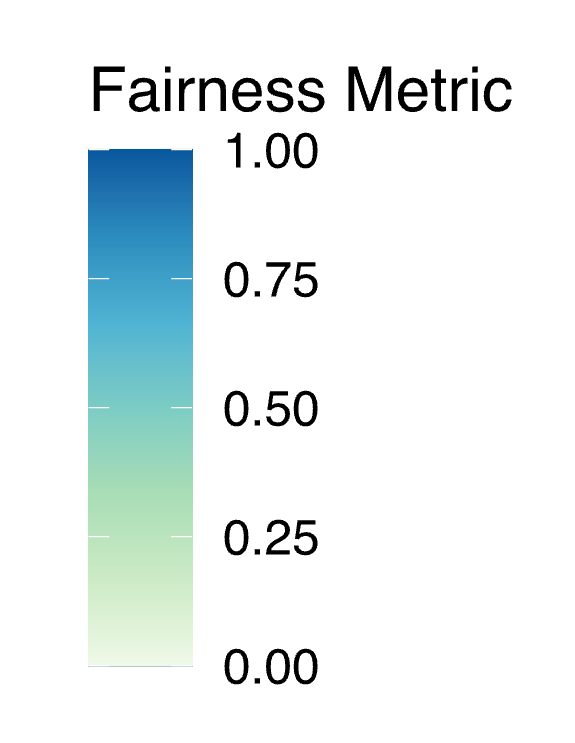{.absolute left=832 top=211 width=248 fig-alt="Fairness metric colour scale"}

<svg class="overlay marker" viewBox="0 0 1280 720"><ellipse class="fragment" cx="617" cy="333" rx="64" ry="145"/></svg>

## **Study 2:** Evaluation

Different strategies to evaluate *a single model*.

::: {.fragment}
**3 Decisions**

::: {.plain}
- *Grouping of Protected Attribute* [→ Omitted Populations]{.red}
- *Exclusion of Subgroups during Evaluation*
- *Evaluate on a Subset*
:::
:::

::: {.pipeline nodes="k k k k k b"}
:::

## **Study 2:** Results

::: {.narrow style="--w:560px"}
- 28 evaluations for each model from Study 1

::: {.fragment fragment-index=1}
- **94.51%** of models from Study 1 have a range of Δ~EOD~ **≥ 0.9** on the fairness metric [0 - 1] for the *exact same model*
:::

::: {.fragment fragment-index=2}
- Histogram for **single model** with *median* variation across different evaluations
:::
:::

::: {.fragment fragment-index=1}
[$\Delta_{\mathrm{EOD}}=\max(EOD)-\min(EOD)$]{.absolute .lbl left=660 top=82 width=600}

[(across the 28 evaluations, for each model from Study 1)]{.absolute .lbl .small .muted left=660 top=132 width=600}
:::

::: {.fragment fragment-index=2}
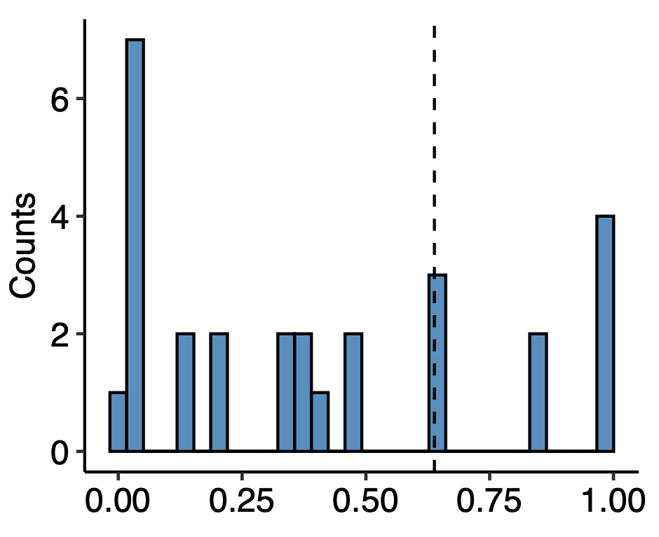{.absolute left=652 top=204 width=560 fig-alt="Fairness metric histogram for the model with median evaluation variation"}

[Fairness Metric]{.absolute .lbl .small left=883 top=668 width=187}
:::

::: {.notes}
Explain delta = max – min for any given model
:::

## **Study 2:** Results

<video class="absolute" data-autoplay muted playsinline src="assets/interactive-multiverse.mp4" style="left:0;top:145px;width:1280px"></video>

## Interactive Analysis {visibility="hidden"}

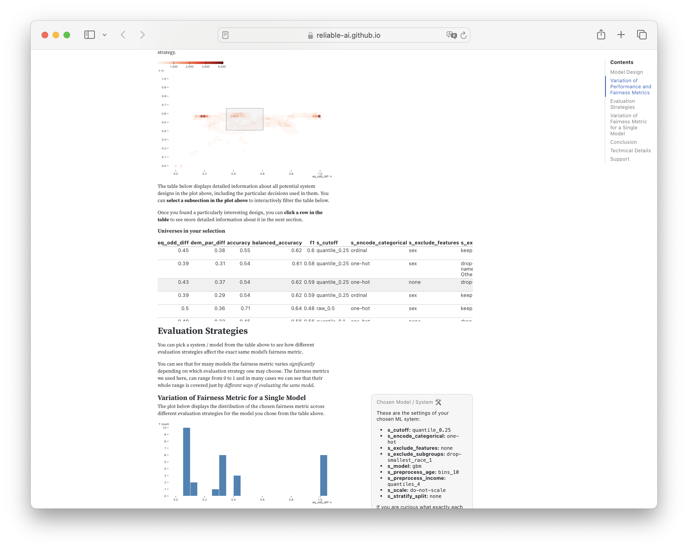{.absolute left=192 top=134 width=858 fig-alt="Interactive multiverse analysis screenshot"}

## **Key Points**

- Non-obvious decisions *can* matter for algorithmic fairness and are worth investigating
  - Fairness metrics are *very* susceptible to changes in evaluation strategy
- Multiverse Analyses are a promising tool to …
  a) Better understand the influence of design decisions
  b) Protect against malicious changes in evaluation (fairness hacking)
- Multiverse Analyses are flexible
  - Can be applied to e.g, only design or evaluation decisions

## → Could we restrict or better navigate the multiverse? {.section-slide}

Given computational constraints, potentially problematic decisions and opportunities of "hacking metrics"

# [**Contribution —**]{.kicker} Preventing Harmful Data Practices by using Participatory Input to Navigate the Machine Learning Multiverse {#participatory-multiverse .contribution}

::: {.faces}
{.absolute left=87 top=112 fig-alt="Coauthor portrait"}
{.absolute left=207 top=112 fig-alt="Coauthor portrait"}
{.absolute left=327 top=110 fig-alt="Coauthor portrait"}
:::

{.absolute left=1030 top=47 width=200 fig-alt="CHI logo"}

::: {.byline}
**Jan Simson**, Fiona Draxler, Samuel Mehr, Christoph Kern

[Proceedings of the 2025 CHI Conference on Human Factors in Computing Systems, CHI '25 https://doi.org/10.1145/3706598.3713482]{.venue}
:::

::: {.pipeline .compact nodes="k b b b b b"}
:::

## **What Did we Do?**

::: {.narrow style="--w:600px"}
- Survey where we asked laypeople how they would build an ADM system

::: {.fragment fragment-index=1}
- Scenario: *ACSPublicCoverage*
:::

::: {.fragment fragment-index=2}
- 4 Model Design Decisions
  - *Exclude Subgroups, Exclude Features, Preprocess Income, Model*
- 4 Evaluation Decisions
  - *Eval Fairness Definition, Eval Fairness Grouping, Eval on Subset, Eval Exclude Subgroups*
:::
:::

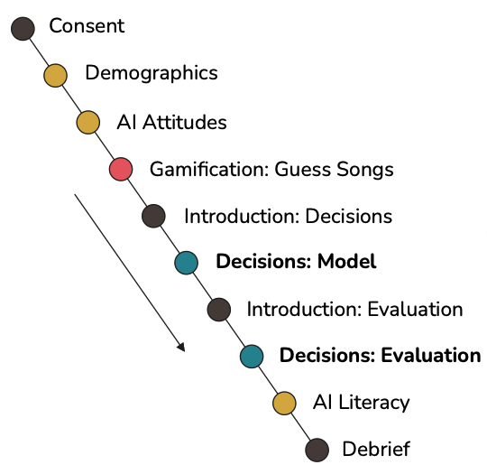{.absolute left=686 top=77 width=537 fig-alt="Survey structure"}

## **Example:** *Exclude Features*

::: {.question}
**What kind of information should an AI system use?** Sometimes AI systems take into account potentially sensitive characteristics […]

[…]
:::

::: {.options .opt-regular}
- **Do not exclude any sensitive characteristics:** This means the AI is trained with all available information, including sensitive characteristics like race and sex.
- **Exclude race from the system:** This means the AI uses all information available but not race.
- […]
:::

::: {.options .opt-other}
- I don't understand the description
- I prefer not to answer
- Suggest an alternative option: __________
:::

## **Going Online**

::: {.narrow style="--w:430px"}
- Published on citizen science website
  - themusiclab.org
- N = 375 complete sessions
  - Multiple countries
  - WEIRD bias (especially U.S.)
:::

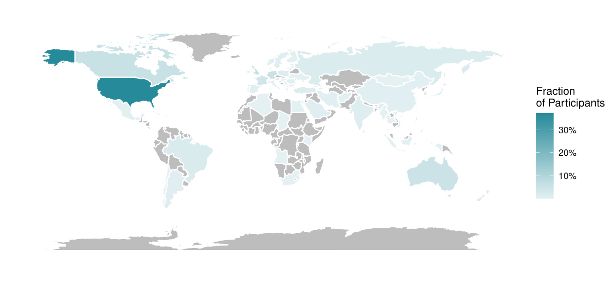{.absolute left=525 top=249 width=728 fig-alt="Geographic distribution of participants"}

## **Results** {auto-animate=true}

::: {.narrow style="--w:640px"}
- Meaningful responses
- High agreement, but also diversity in responses
- A notable number of people skip through the study
:::

::: {.stage}
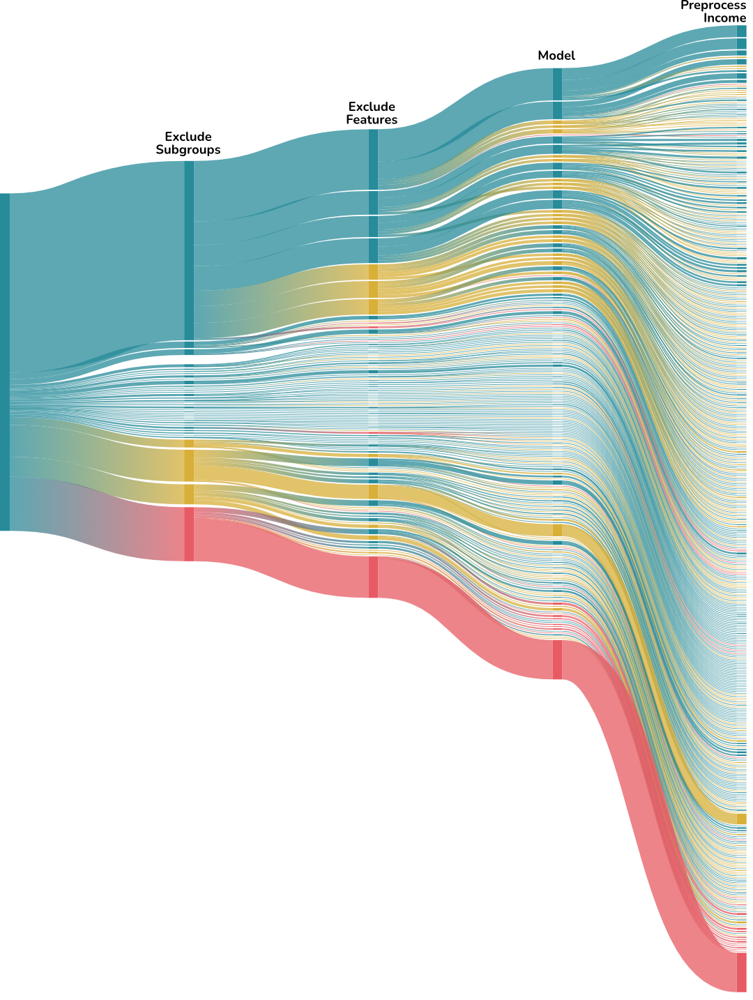{.absolute data-id="responses" left=780 top=71 width=478 fig-alt="Participant responses across decisions"}
:::

## {auto-animate=true}

::: {.stage}
{.absolute data-id="responses" left=17 top=28 width=1058 fig-alt="Participant responses, zoomed into the top"}
{.absolute data-id="responses-legend" left=17 top=19 width=605 style="clip-path:inset(0 0 23.466% 0);" fig-alt="Legend: type of response"}
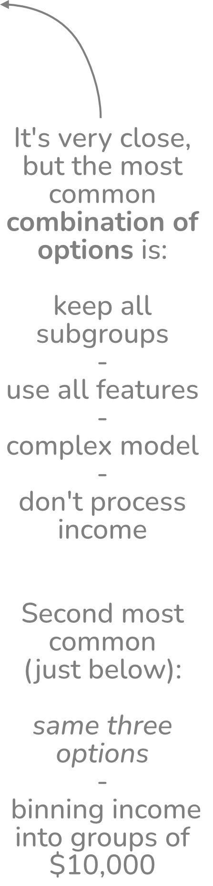{.absolute data-id="responses-note-top" left=1073 top=67 width=145 fig-alt="The most common combination of options"}
:::

## {auto-animate=true auto-animate-duration=1.5}

::: {.stage}
{.absolute data-id="responses" left=165 top=-514 width=919 fig-alt="Participant responses, zoomed into the bottom"}
{.absolute data-id="responses-legend" left=17 top=-264 width=605 style="clip-path:inset(0 0 23.466% 0);" fig-alt=""}
{.absolute data-id="responses-legend-bottom" left=17 top=479 width=605 style="clip-path:inset(0 0 23.466% 0);" fig-alt="Legend: type of response"}
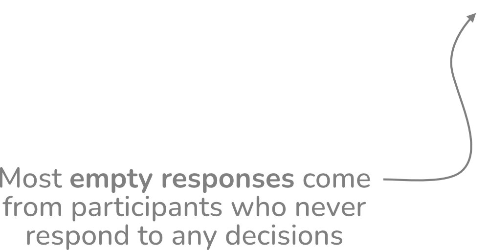{.absolute data-id="responses-note-empty" left=232 top=236 width=439 fig-alt="Most empty responses come from participants who never respond to any decisions"}
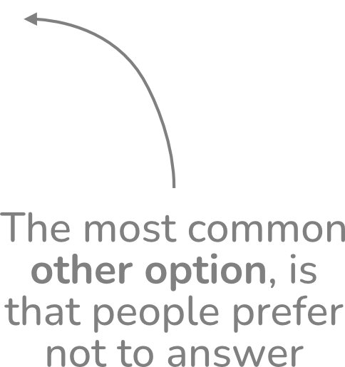{.absolute data-id="responses-note-other" left=1088 top=475 width=180 fig-alt="The most common other option is that people prefer not to answer"}
:::

## Different People Make Different Choices

- Responses differ between different groups
  1. Higher rate of inclusion for one's own subgroup
  2. More likely to suggest alternatives by those with high AI literacy

. . .

- Compared only a small subset of possible comparisons

[**→ Importance of diverse sample**]{.takeaway}

## Participatory Input Leads to **Well-performing Models**

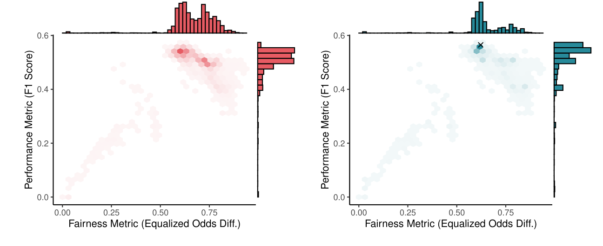{.absolute left=85 top=230 width=1111 fig-alt="Performance and fairness of full and participatory multiverses"}

[**Full Multiverse**]{.absolute .lbl .small left=280 top=194 width=187}
[**Participatory Multiverse**]{.absolute .lbl .small left=779 top=194 width=290}
[← Lower is better]{.absolute .lbl .axis-hint left=306 top=668 width=135}
[← Lower is better]{.absolute .lbl .axis-hint left=856 top=668 width=135}
[Higher is better →]{.absolute .lbl .axis-hint .vertical left=33 top=450 width=139}
[Higher is better →]{.absolute .lbl .axis-hint .vertical left=587 top=450 width=139}

<svg class="overlay marker" viewBox="0 0 1280 720"><path class="fragment" data-fragment-index="0" d="M975 392Q968 345 932 326M940.5 339.5L932 326L948 325.4" style="stroke-width:4;stroke-linecap:round;stroke-linejoin:round"/><ellipse class="fragment" data-fragment-index="1" cx="1005" cy="263" rx="101" ry="45" style="stroke-width:3"/></svg>

## **Key Points**

- Non-developers can provide meaningful input on ML design

. . .

- Participatory input can help combat "lazy" data practices and produces reasonable & competitive models
  - (Dis)agreement can be a helpful signal

. . .

- Involving a diverse set of stakeholders matters

# **Closing** **& Outlook** {#closing .section-slide}

## **Closing:** Re-Evaluating the ML Pipeline

::: {.pipeline}
:::

- Discovered problematic *"lazy" data practices* in the field

. . .

- Saw how fairness metrics can be *hacked* by changing the *evaluation protocol*

. . .

- *(Participatory) multiverse analyses* as potential remedies and powerful methodologies

::: {.notes}
We saw effective techniques of how the machine learning pipeline can be re-evaluated
:::

## **Outlook**

- Dataset annotations limited in scope → expand scope
  - (Partially) automate annotations

. . .

- Arbitrariness in choice of *plausible* decisions
  - Systematic discovery of decision points

. . .

- "Consultation" in participatory multiverse
  - More empowering forms, e.g., co-design of participatory process

. . .

- Expand into other domains, e.g., text, image

## **Thank you!** {.section-slide}

::: {.pipeline .bare y=514}
:::

## References {.scrollable .references-slide}

::: {#refs}
:::

