## Research Findings and How They May Inform Practice {#slide-01 .opening-slide}

<!-- Original PowerPoint slide 1 -->

{height=95 fig-alt="LMU München"}

## Intro — The Machine Learning Pipeline {#slide-02 .section-slide}

<!-- Original PowerPoint slide 2 -->

::: {.notes}
Getting a good and fair model needs this pipeline
:::

## The Machine Learning Pipeline {#slide-03}

<!-- Original PowerPoint slide 3 -->

- Several high-level frameworks exist for “*Data Science Life Cycle*”
  - e.g., CRISP-DM (Chapman et al., 2000), PCS Framework (Yu and Kumbier, 2020; Yu and Barter, 2024)

::: {.fragment .appear data-fragment-index="0"}
- No comprehensive frameworks for the “ML Pipeline”
  - Clearest specifications often in AutoML
  - Technical implementations of pipelines in libraries (Pedragosa et al., 2011; Binder et al. 2021)
  - High variety of ML pipelines (Xin et al., 2021)
  - At least partially dataset-specific (Zöller and Huber, 2021)
:::

## The Machine Learning Pipeline {#slide-04 .pipeline-slide auto-animate=true auto-animate-id="pipeline-intro" auto-animate-duration="1" auto-animate-easing="ease-in-out"}

<!-- Original PowerPoint slide 4 -->

::: {.simple-pipeline}
🗄️ → 🤖 → ✅️ / ❌️
:::

**Not quite that simple**

## The Machine Learning Pipeline {#slide-05 .pipeline-slide auto-animate=true auto-animate-id="pipeline-intro" auto-animate-duration="1" auto-animate-easing="ease-in-out"}

<!-- Original PowerPoint slide 5 -->

::: {data-id="pipeline" .pipeline .large}

| 🗄️ |  | 🤖 |  | ✅️ / ❌️ |  |
| :---: | :---: | :---: | :---: | :---: | :---: |
| Data | (Pre-)Processing | Model | Predictions | Decisions | Evaluation |

:::

::: {.small}
Simplified illustration, drawing on Zöller and Huber (2021) and Simson et al. (2024)
:::

::: {.notes}
There’s more, both in depth i.e. you could zoom in and outside of this e.g. data sourcing and deployment.
:::

## Should we Re-Evaluate this Pipeline? {#slide-06 .pipeline-slide}

<!-- Original PowerPoint slide 6 -->

::: {.pipeline .large}

| 🗄️ |  | 🤖 |  | ✅️ / ❌️ |  |
| :---: | :---: | :---: | :---: | :---: | :---: |
| Data | (Pre-)Processing | Model | Predictions | Decisions | Evaluation |

:::

::: {.small}
Simplified illustration, drawing on Zöller and Huber (2021) and Simson et al. (2024)
:::

::: {.notes}
Should we re-evaluate this pipeline and if so – how?
:::

## Contributions {#slide-07 auto-animate=true auto-animate-id="contribution" auto-animate-duration="0.5" auto-animate-easing="ease-in-out"}

<!-- Original PowerPoint slide 7 -->

:::: {.columns}
::: {.column width="52%"}
- Lazy Data Practices
- Multiverse Analysis for Algorithmic Fairness
- Participatory Multiverse
:::
::: {.column width="48%"}
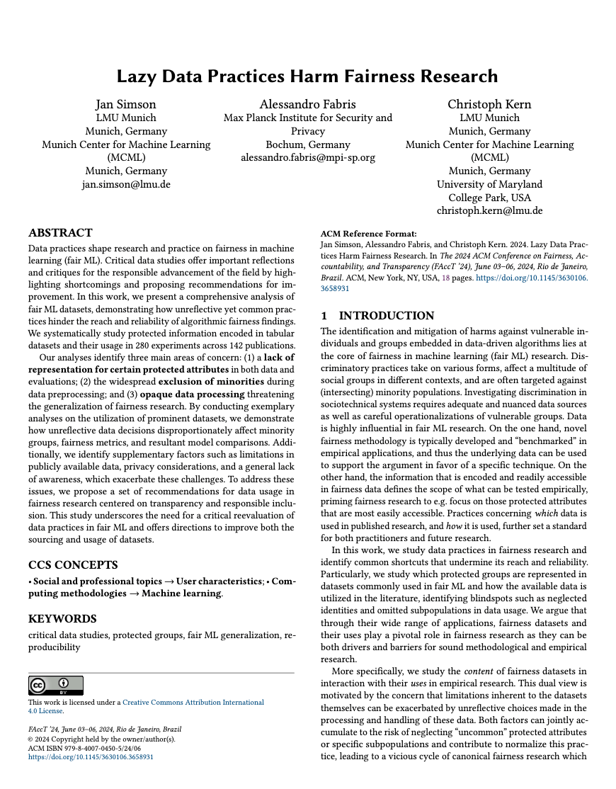{height=200 fig-alt="Research paper cover"} 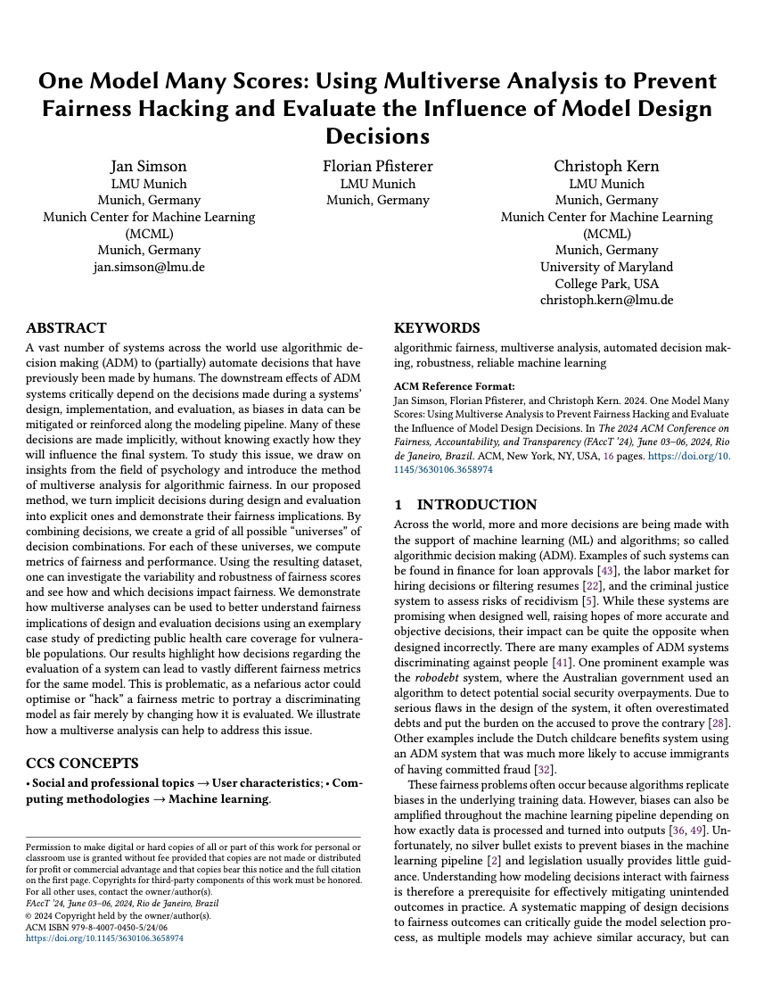{height=200 fig-alt="Research paper cover"} 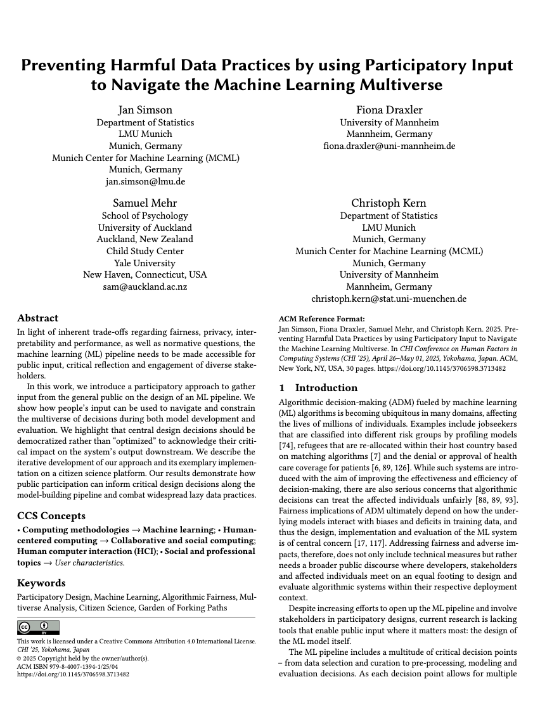{height=200 fig-alt="Research paper cover"}
:::
::::

::: {data-id="pipeline" .pipeline}

| ● | ● | ● | ● | ● | ● |
| :---: | :---: | :---: | :---: | :---: | :---: |
| **Data** | **(Pre-)Processing** | **Model** | **Predictions** | **Decisions** | **Evaluation** |

:::

## Contribution — Lazy Data Practices Harm Fairness Research {#slide-08 .contribution auto-animate=true auto-animate-id="contribution" auto-animate-duration="0.5" auto-animate-easing="ease-in-out"}

<!-- Original PowerPoint slide 8 -->

{height=65 fig-alt="Coauthor portrait"} {height=65 fig-alt="Coauthor portrait"} {height=65 fig-alt="Conference logo"}

::: {.small}
**Jan Simson**, Alessandro Fabris, Christoph Kern

Proceedings of the 2024 ACM Conference on Fairness, Accountability, and Transparency, FAccT ’24 https://doi.org/10.1145/3630106.3658931
:::

::: {data-id="pipeline" .pipeline}

| ● | ● | ● | ● | ● | ● |
| :---: | :---: | :---: | :---: | :---: | :---: |
| **Data** | **(Pre-)Processing** | Model | Predictions | Decisions | Evaluation |

:::

## How are Datasets used in FairML? {#slide-09}

<!-- Original PowerPoint slide 9 -->

- Build on systematic review of literature (Fabris et al., 2022)
  - Papers at major ML and FairML conferences matching fairness related keywords
  - Focus on fair classification and tabular datasets

::: {.fragment .appear data-fragment-index="0"}
- **N = 142 publications**    //    **N = 280 experiments**
:::

::: {.fragment .appear data-fragment-index="1"}
- Annotate how datasets are *used*
  - Protected Attributes, Target, Features
  - Processing
  - Enough Information?
:::

## Lazy Practice #1: Neglected Identities {#slide-10}

<!-- Original PowerPoint slide 10 -->

- Noticed many publications focusing on the same narrow set of protected / sensitive attributes

::: {.fragment .appear data-fragment-index="0"}
- Compare with a list of protected attributes (*non-exhaustive*)
  - From human rights treaties & anti-discrimination laws: UN Charter, African Charter, Arab Charter, ASEAN Declaration, European Charter, American Declaration, US Fair Lending, EU Fair Hiring
:::

## Protected Attributes in Different Legislations {#slide-11}

<!-- Original PowerPoint slide 11 -->

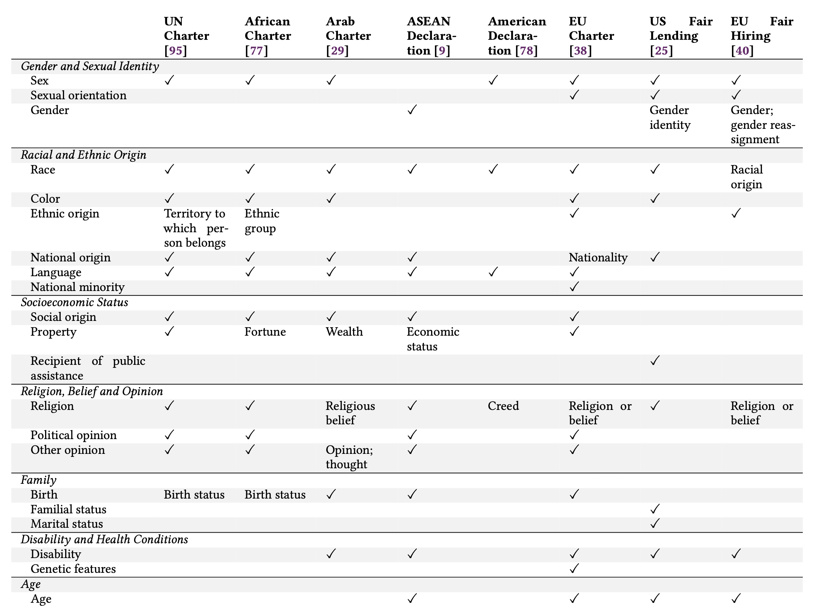{height=510 fig-alt="Protected attributes across human-rights treaties and anti-discrimination laws"}

::: {.small}
✔️: Literal phrasing matches row header, raw text otherwise
:::

## Lazy Practice #1 Neglected Identities {#slide-12 auto-animate=true auto-animate-id="attributes" auto-animate-duration="1" auto-animate-easing="ease-in-out"}

<!-- Original PowerPoint slide 12 -->

::: {.small}
Protected Attribute
:::

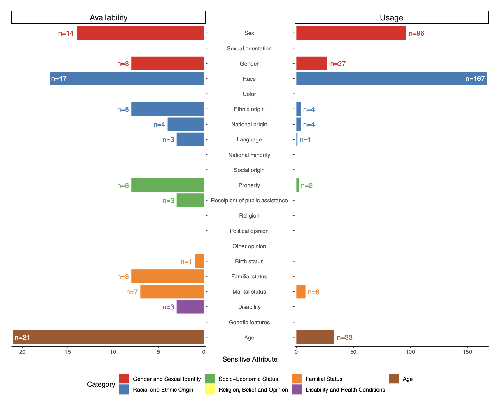

::: {.notes}
21 attributes
Race and religion across all of them
:::

## Lazy Practice #1 Neglected Identities {#slide-13 auto-animate=true auto-animate-id="attributes" auto-animate-duration="1" auto-animate-easing="ease-in-out"}

<!-- Original PowerPoint slide 13 -->

::: {.small}
Protected Attribute · Availability (in Datasets), N = 36
:::

## Lazy Practice #1 Neglected Identities {#slide-14 auto-animate=true auto-animate-id="attributes" auto-animate-duration="1" auto-animate-easing="ease-in-out"}

<!-- Original PowerPoint slide 14 -->

::: {.small}
Protected Attribute · Availability (in Datasets), N = 36 · Usage (in Literature), N = 233
:::

::: {.notes}
Literature, number of experiments (with sufficient information)
:::

## Lazy Practice #2: Omitted Populations {#slide-15}

<!-- Original PowerPoint slide 15 -->

:::: {.columns}
::: {.column width="44%"}
- Populations are frequently omitted in preprocessing

::: {.fragment .appear data-fragment-index="0"}
- Annotated processing of *race* for *N* = 69 articles using COMPAS (Angwin et al., 2016)
:::

::: {.fragment .appear data-fragment-index="1"}
- Most publications (**89.8%**) reduced the data to just two groups
:::

::: {.fragment .appear data-fragment-index="2"}
- **None** of the strategies keep Asians or Native Americans as distinct groups
:::

:::
::: {.column width="56%"}
::: {.fragment .appear data-fragment-index="1"}
::: {.small}
Handling of protected groups
:::
:::

::: {.fragment .appear data-fragment-index="1"}
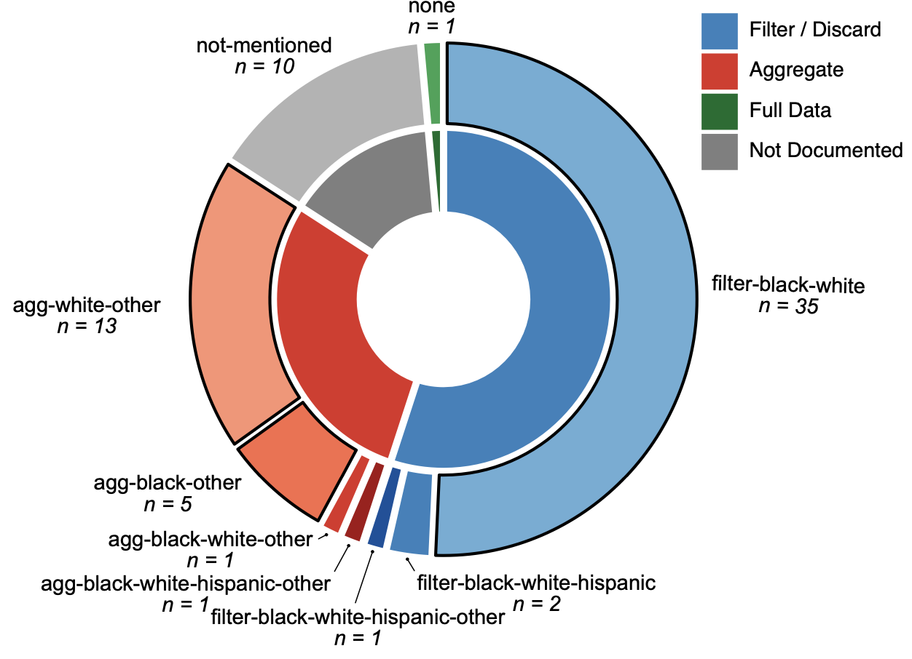{height=460 fig-alt="Handling of protected groups in COMPAS articles"}
:::

:::
::::

::: {.notes}
Guide: filter (blue), aggregate (red)
90% (black borders) retain only TWO GROUPS
None keep Asians / native Americas as distinct groups around
:::

## Lazy Practice #3.1: Opaque Preprocessing {#slide-16}

<!-- Original PowerPoint slide 16 -->

:::: {.columns}
::: {.column width="43%"}
- Many articles do not provide enough information to reconstruct dataset usage

::: {.fragment .appear data-fragment-index="0"}
- Even fewer have source code of analyses available (39%)
:::

:::
::: {.column width="57%"}
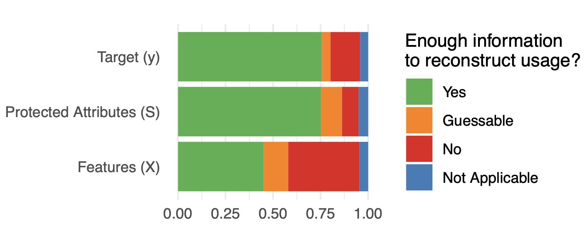{height=255 fig-alt="Enough information to reconstruct usage"}

::: {.fragment .appear data-fragment-index="0"}
{height=135 fig-alt="Availability of source code"}
:::

:::
::::

## Lazy Practice #3.2: Opaque Preprocessing {#slide-17 auto-animate=true auto-animate-id="bank" auto-animate-duration="1" auto-animate-easing="ease-in-out"}

<!-- Original PowerPoint slide 17 -->

:::: {.columns}
::: {.column width="38%"}
- Annotated usage for *N* = 9 articles using Bank Marketing (Moro et al., 2012) dataset
:::
::: {.column width="62%"}

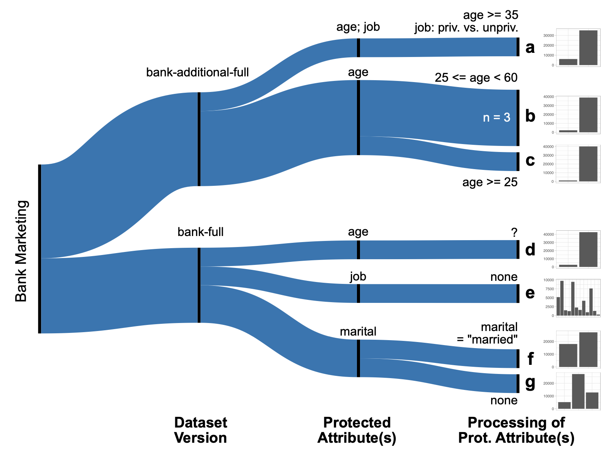

:::
::::

## Lazy Practice #3.2: Opaque Preprocessing {#slide-18 auto-animate=true auto-animate-id="bank" auto-animate-duration="1" auto-animate-easing="ease-in-out"}

<!-- Original PowerPoint slide 18 -->

:::: {.columns}
::: {.column width="38%"}
- Annotated usage for *N* = 9 articles using Bank Marketing (Moro et al., 2012) dataset
:::
::: {.column width="62%"}

:::
::::

## Lazy Practice #3.2: Opaque Preprocessing {#slide-19 auto-animate=true auto-animate-id="bank" auto-animate-duration="1" auto-animate-easing="ease-in-out"}

<!-- Original PowerPoint slide 19 -->

:::: {.columns}
::: {.column width="38%"}
- Annotated usage for *N* = 9 articles using Bank Marketing (Moro et al., 2012) dataset
:::
::: {.column width="62%"}

:::
::::

## Lazy Practice #3.2: Opaque Preprocessing {#slide-20 auto-animate=true auto-animate-id="bank" auto-animate-duration="1" auto-animate-easing="ease-in-out"}

<!-- Original PowerPoint slide 20 -->

:::: {.columns}
::: {.column width="38%"}
- Annotated usage for *N* = 9 articles using Bank Marketing (Moro et al., 2012) dataset

- *N* = 7 different variants of usage, all using the *“same”* dataset
  - Variants affect model choice / fairness metrics
  - Lower bound of variation (only three decisions)
:::
::: {.column width="62%"}

:::
::::

## Key Points {#slide-21}

<!-- Original PowerPoint slide 21 -->

:::: {.columns}
::: {.column width="72%"}
- **Neglected Identities** in availability and usage of prot. attributes

::: {.fragment .appear data-fragment-index="0"}
- **Omitted Populations** during the preprocessing of data
:::

::: {.fragment .appear data-fragment-index="1"}
- **Opaque Preprocessing:** High variability & lack of documentation
  - Which version of a dataset was used
  - Reproducible source code of analyses
:::

:::
::: {.column width="28%"}
::: {.fragment .appear data-fragment-index="2"}
{height=245 fig-alt="FairGround logo"}

FairGround
:::

:::
::::

::: {.notes}
These are hard (!) and some may require also changes on the reviewer side, but worthwhile for us as a field to improve.
:::

## → We examined the effect of only three small processing decisions, what happens if we look at more? {#slide-22 .section-slide}

<!-- Original PowerPoint slide 22 -->

## Contribution — One Model Many Scores: Using Multiverse Analysis to Prevent Fairness Hacking and Evaluate the Influence of Model Design Decisions {#slide-23 .contribution}

<!-- Original PowerPoint slide 23 -->

{height=65 fig-alt="Coauthor portrait"} {height=65 fig-alt="Coauthor portrait"} {height=65 fig-alt="Conference logo"}

::: {.small}
**Jan Simson**, Florian Pfisterer, Christoph Kern

Proceedings of the 2024 ACM Conference on Fairness, Accountability, and Transparency, FAccT ’24 https://doi.org/10.1145/3630106.3658974
:::

::: {.pipeline}

| ● | ● | ● | ● | ● | ● |
| :---: | :---: | :---: | :---: | :---: | :---: |
| Data | **(Pre-)Processing** | **Model** | **Predictions** | **Decisions** | **Evaluation** |

:::

## The Machine Learning Pipeline {#slide-24 .pipeline-slide auto-animate=true auto-animate-id="pipeline-decisions" auto-animate-duration="1" auto-animate-easing="ease-in-out"}

<!-- Original PowerPoint slide 24 -->

::: {data-id="pipeline" .pipeline .large}

| 🗄️<svg class="pipeline-fork" data-id="fork-0" viewBox="0 0 120 40" style="clip-path:inset(0 100% 0 0)"><path d="M0 20 Q25 20 30 9 L65 9 M0 20 Q25 20 30 31 L65 31 M59 5 L65 9 L59 13 M59 27 L65 31 L59 35" fill="none" stroke="currentColor" stroke-width="2"/></svg> | <svg class="pipeline-fork" data-id="fork-1" viewBox="0 0 120 40" style="clip-path:inset(0 100% 0 0)"><path d="M0 20 Q25 20 30 9 L65 9 M0 20 Q25 20 30 31 L65 31 M59 5 L65 9 L59 13 M59 27 L65 31 L59 35" fill="none" stroke="currentColor" stroke-width="2"/></svg> | 🤖<svg class="pipeline-fork" data-id="fork-2" viewBox="0 0 120 40" style="clip-path:inset(0 100% 0 0)"><path d="M0 20 Q25 20 30 9 L65 9 M0 20 Q25 20 30 31 L65 31 M59 5 L65 9 L59 13 M59 27 L65 31 L59 35" fill="none" stroke="currentColor" stroke-width="2"/></svg> | <svg class="pipeline-fork" data-id="fork-3" viewBox="0 0 120 40" style="clip-path:inset(0 100% 0 0)"><path d="M0 20 Q25 20 30 9 L65 9 M0 20 Q25 20 30 31 L65 31 M59 5 L65 9 L59 13 M59 27 L65 31 L59 35" fill="none" stroke="currentColor" stroke-width="2"/></svg> | ✅️ / ❌️<svg class="pipeline-fork" data-id="fork-4" viewBox="0 0 120 40" style="clip-path:inset(0 100% 0 0)"><path d="M0 20 Q25 20 30 9 L65 9 M0 20 Q25 20 30 31 L65 31 M59 5 L65 9 L59 13 M59 27 L65 31 L59 35" fill="none" stroke="currentColor" stroke-width="2"/></svg> | <svg class="pipeline-fork" data-id="fork-5" viewBox="0 0 120 40" style="clip-path:inset(0 100% 0 0)"><path d="M0 20 Q25 20 30 9 L65 9 M0 20 Q25 20 30 31 L65 31 M59 5 L65 9 L59 13 M59 27 L65 31 L59 35" fill="none" stroke="currentColor" stroke-width="2"/></svg> |
| :---: | :---: | :---: | :---: | :---: | :---: |
| Data | (Pre-)Processing | Model | Predictions | Decisions | Evaluation |

:::

## A Pipeline Full of Design Decisions {#slide-25 .pipeline-slide auto-animate=true auto-animate-id="pipeline-decisions" auto-animate-duration="1" auto-animate-easing="ease-in-out"}

<!-- Original PowerPoint slide 25 -->

::: {data-id="pipeline" .pipeline .large}

| 🗄️<svg class="pipeline-fork" data-id="fork-0" viewBox="0 0 120 40" style="clip-path:inset(0 0% 0 0)"><path d="M0 20 Q25 20 30 9 L65 9 M0 20 Q25 20 30 31 L65 31 M59 5 L65 9 L59 13 M59 27 L65 31 L59 35" fill="none" stroke="currentColor" stroke-width="2"/></svg> | <svg class="pipeline-fork" data-id="fork-1" viewBox="0 0 120 40" style="clip-path:inset(0 0% 0 0)"><path d="M0 20 Q25 20 30 9 L65 9 M0 20 Q25 20 30 31 L65 31 M59 5 L65 9 L59 13 M59 27 L65 31 L59 35" fill="none" stroke="currentColor" stroke-width="2"/></svg> | 🤖<svg class="pipeline-fork" data-id="fork-2" viewBox="0 0 120 40" style="clip-path:inset(0 0% 0 0)"><path d="M0 20 Q25 20 30 9 L65 9 M0 20 Q25 20 30 31 L65 31 M59 5 L65 9 L59 13 M59 27 L65 31 L59 35" fill="none" stroke="currentColor" stroke-width="2"/></svg> | <svg class="pipeline-fork" data-id="fork-3" viewBox="0 0 120 40" style="clip-path:inset(0 0% 0 0)"><path d="M0 20 Q25 20 30 9 L65 9 M0 20 Q25 20 30 31 L65 31 M59 5 L65 9 L59 13 M59 27 L65 31 L59 35" fill="none" stroke="currentColor" stroke-width="2"/></svg> | ✅️ / ❌️<svg class="pipeline-fork" data-id="fork-4" viewBox="0 0 120 40" style="clip-path:inset(0 0% 0 0)"><path d="M0 20 Q25 20 30 9 L65 9 M0 20 Q25 20 30 31 L65 31 M59 5 L65 9 L59 13 M59 27 L65 31 L59 35" fill="none" stroke="currentColor" stroke-width="2"/></svg> | <svg class="pipeline-fork" data-id="fork-5" viewBox="0 0 120 40" style="clip-path:inset(0 0% 0 0)"><path d="M0 20 Q25 20 30 9 L65 9 M0 20 Q25 20 30 31 L65 31 M59 5 L65 9 L59 13 M59 27 L65 31 L59 35" fill="none" stroke="currentColor" stroke-width="2"/></svg> |
| :---: | :---: | :---: | :---: | :---: | :---: |
| Data | (Pre-)Processing | Model | Predictions | Decisions | Evaluation |

:::

::: {.small}
Garden of forking paths (Gelman and Loken, 2014)
:::

## In the End, We Create Only One Of Many Potential Models {#slide-26}

<!-- Original PowerPoint slide 26 -->

:::: {.columns}
::: {.column width="60%"}

::: {.fragment .appear data-fragment-index="0"}
- Explicitly combine plausible decisions to generate a *multiverse* of models
:::

::: {.fragment .appear data-fragment-index="1"}
- *Multiverse Analysis:* Traverse and explore universes in the multiverse
  - From Psychology (Steegen et. al, 2016)
:::

::: {.fragment .appear data-fragment-index="2"}
- We adapt this for fairness (and ML)
  - Compute fairness metric for each *universe*
  - Demonstrate across two studies
:::

:::
::: {.column width="40%"}
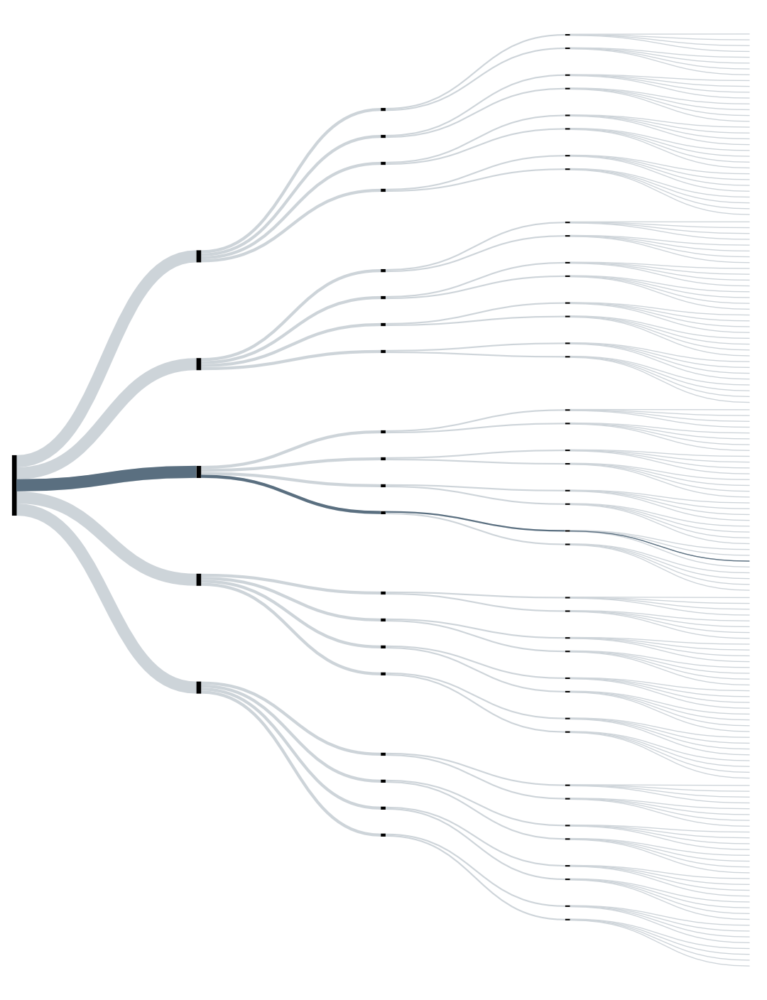{height=440 fig-alt="Branching model multiverse"}
:::
::::

## Case Study: Dataset {#slide-27}

<!-- Original PowerPoint slide 27 -->

- **Predict public health care coverage**
- ACSPublicCoverage in folktables (Ding et. al, 2021)
  - Based on US Census data for state of California

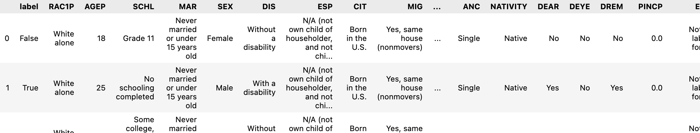{height=270 fig-alt="ACSPublicCoverage sample rows"}

::: {.notes}
N = 138,554 rows;  p = 19 features
:::

## Study 1: Model Design Decisions {#slide-28}

<!-- Original PowerPoint slide 28 -->

- 9 (often implicit) Decisions → *N* = 61,440 universes simulated
- **Preprocessing**
  - *Exclude Features, Exclude Subgroups*
  - *Scale, Preprocess Age, Preprocess Income, Encoding of* *Categoricals*
- **Model**
  - *Model Type, Stratify Split*
- **Decision**
  - *Cutoff*

::: {.pipeline}

| ● | ● | ● | ● | ● | ● |
| :---: | :---: | :---: | :---: | :---: | :---: |
| Data | **(Pre-)Processing** | **Model** | Predictions | **Decisions** | Evaluation |

:::

::: {.notes}
Design Decisions => lead to different models

e.g. using a different model type such
:::

## Equalized Odds Difference {#slide-29}

<!-- Original PowerPoint slide 29 -->

- **Separation:** Error rates should be equal across all groups $g$ of $S$
  - aka: Equalized odds, disparate mistreatment, error rate balance and more (Pessach and Shmueli, 2022)

$$
\begin{aligned}
P(\hat{Y}=1 \mid Y=1,S=g_1)&=P(\hat{Y}=1 \mid Y=1,S=g_2) &&\text{(TPR)}\\
P(\hat{Y}=1 \mid Y=0,S=g_1)&=P(\hat{Y}=1 \mid Y=0,S=g_2) &&\text{(FPR)}
\end{aligned}
$$

::: {.fragment .appear data-fragment-index="0"}
- **Equalized Odds Difference:** Maximum difference in TPR and FPR between different groups $g$ of $S$ (Weerts et al., 2023)
  - Lower is better; ranges from 0 to 1
:::

::: {.small}
$S$: prot. attr. · $\hat{Y}$: prediction = decision · $Y$: ground truth
:::

## There is a Lot of Variation in the Multiverse {#slide-30}

<!-- Original PowerPoint slide 30 -->

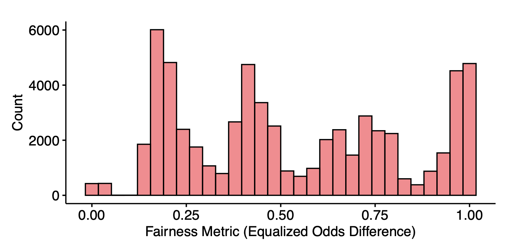{height=470 fig-alt="Distribution of equalized odds difference across the multiverse"}

::: {.small}
← Lower is better
:::

## How Can we Attribute this Variation? {#slide-31}

<!-- Original PowerPoint slide 31 -->

- We can use a functional analysis of variance (FANOVA) to decompose the variance (Hooker, 2007)
- Allows identifying the most important decisions …and their interactions → to examine them in detail

::: {.pipeline}

| ● | ● | ● | ● | ● | ● |
| :---: | :---: | :---: | :---: | :---: | :---: |
| Data | (Pre-)Processing | **Model** | Predictions | **Decisions** | **Evaluation** |

:::

## Identifying the Most Important Decisions {#slide-32}

<!-- Original PowerPoint slide 32 -->

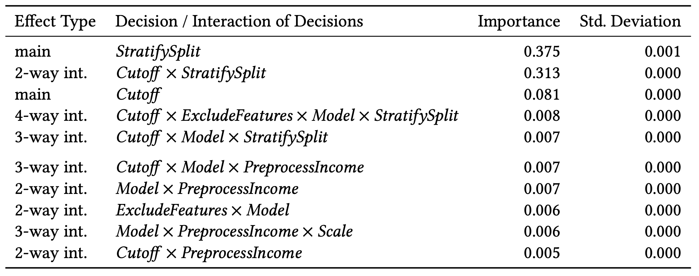{height=445 fig-alt="FANOVA main and interaction effects ranked by importance"}

<svg class="annotation-overlay" viewBox="0 0 1000 400"><path class="fragment appear" data-fragment-index="0" d="M 0 74 H 26 V 62 L 52 86 L 26 110 V 98 H 0" fill="none" stroke="red" stroke-width="3"/></svg>

::: {.notes}
N = 511 main and interaction effects
:::

## Examining Decisions in Detail {#slide-33}

<!-- Original PowerPoint slide 33 -->

:::: {.columns}
::: {.column width="72%"}

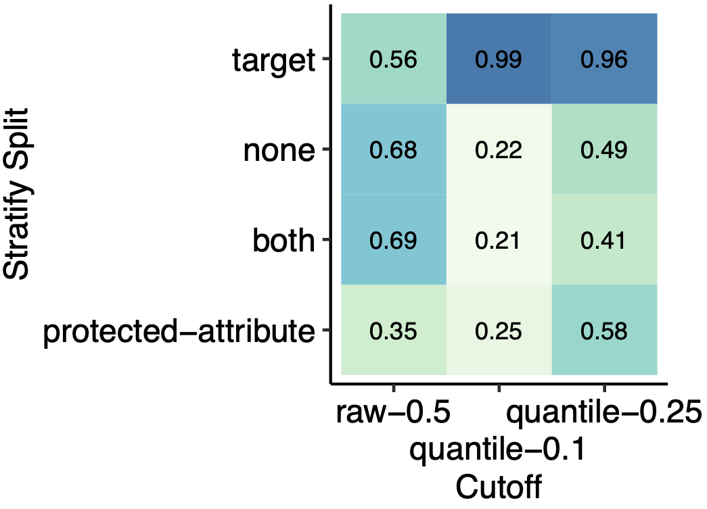{height=420 fig-alt="Fairness heatmap by cutoff and stratification"}

<svg class="annotation-overlay" viewBox="0 0 763 550"><ellipse class="fragment appear" data-fragment-index="0" cx="540" cy="161" rx="67" ry="151" fill="none" stroke="red" stroke-width="3"/></svg>

:::
::: {.column width="28%"}
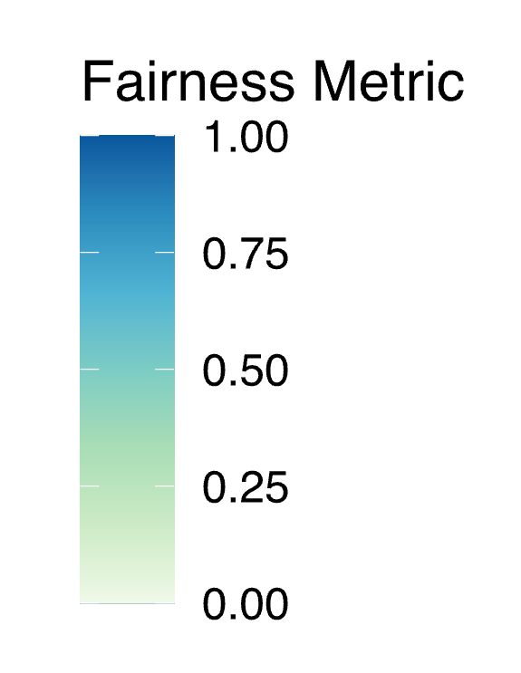{height=320 fig-alt="Additional cutoff comparison"}
:::
::::

## Study 2: Evaluation {#slide-34}

<!-- Original PowerPoint slide 34 -->

- Different strategies to evaluate *a single model*.

::: {.fragment .appear data-fragment-index="0"}
- **3 Decisions**
:::

::: {.fragment .appear data-fragment-index="0"}
- *Grouping of Protected Attribute* → Omitted Populations
:::

::: {.fragment .appear data-fragment-index="0"}
- *Exclusion of Subgroups during Evaluation*
:::

::: {.fragment .appear data-fragment-index="0"}
- *Evaluate on a Subset*
:::

::: {.pipeline}

| ● | ● | ● | ● | ● | ● |
| :---: | :---: | :---: | :---: | :---: | :---: |
| Data | (Pre-)Processing | Model | Predictions | Decisions | **Evaluation** |

:::

## Study 2: Results {#slide-35}

<!-- Original PowerPoint slide 35 -->

:::: {.columns}
::: {.column width="50%"}
28 evaluations for each model from Study 1

::: {.fragment .appear data-fragment-index="0"}
**94.51%** of models from Study 1 have a range of ΔEOD **≥ 0.9** on the fairness metric [0 - 1] for the *exact same model*
:::

::: {.fragment .appear data-fragment-index="1"}
Histogram for **single model** with *median* variation across different evaluations
:::

:::
::: {.column width="50%"}
::: {.fragment .appear data-fragment-index="0"}
$\Delta_{\mathrm{EOD}}=\max(EOD)-\min(EOD)$

::: {.small}
(across the 28 evaluations, for each model from Study 1)
:::
:::

::: {.fragment .appear data-fragment-index="1"}
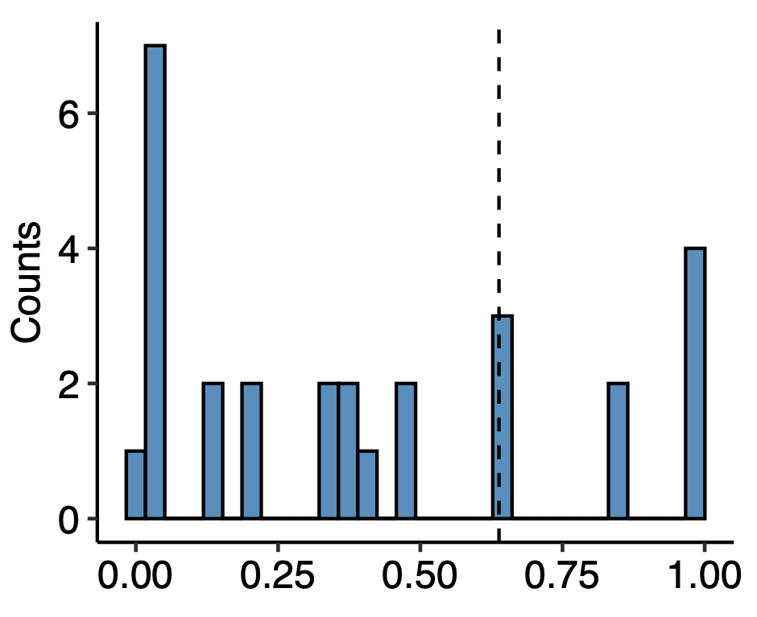{height=330 fig-alt="Fairness metric histogram for the model with median evaluation variation"}
:::

:::
::::

::: {.notes}
Explain delta = max – min for any given model
:::

## Study 2: Results {#slide-36}

<!-- Original PowerPoint slide 36 -->



## Interactive Analysis {#slide-37}

<!-- Original PowerPoint slide 37 (hidden in PowerPoint; included here for completeness) -->

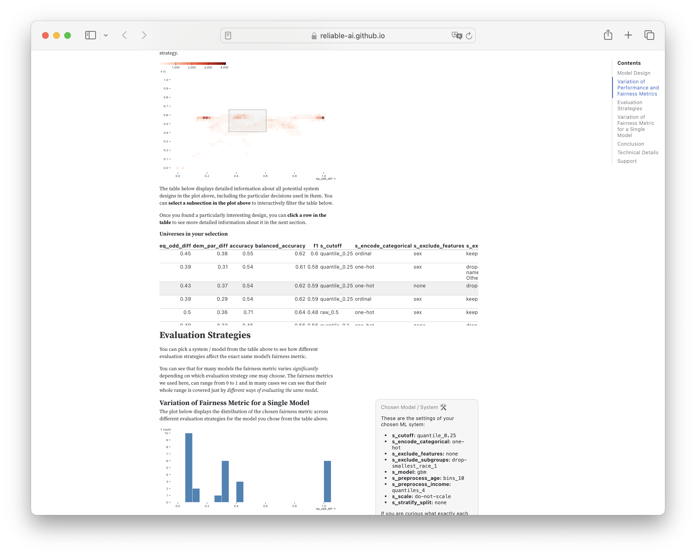{height=500 fig-alt="Interactive multiverse analysis screenshot"}

## Key Points {#slide-38}

<!-- Original PowerPoint slide 38 -->

- Non-obvious decisions *can* matter for algorithmic fairness and are worth investigating
  - Fairness metrics are *very* susceptible to changes in evaluation strategy
- Multiverse Analyses are a promising tool to …
  - Better understand the influence of design decisions
  - Protect against malicious changes in evaluation (fairness hacking)
- Multiverse Analyses are flexible
  - Can be applied to e.g, only design or evaluation decisions

## → Could we restrict or better navigate the multiverse? {#slide-39 .section-slide}

<!-- Original PowerPoint slide 39 -->

Given computational constraints, potentially problematic decisions and opportunities of “hacking metrics”

## Contribution — Preventing Harmful Data Practices by using Participatory Input to Navigate the Machine Learning Multiverse {#slide-40 .contribution}

<!-- Original PowerPoint slide 40 -->

{height=65 fig-alt="Coauthor portrait"} {height=65 fig-alt="Coauthor portrait"} {height=65 fig-alt="Coauthor portrait"} {height=65 fig-alt="Conference logo"}

::: {.small}
**Jan Simson**, Fiona Draxler, Samuel Mehr, Christoph Kern

Proceedings of the 2025 CHI Conference on Human Factors in Computing Systems, CHI ’25 https://doi.org/10.1145/3706598.3713482
:::

::: {.pipeline}

| ● | ● | ● | ● | ● | ● |
| :---: | :---: | :---: | :---: | :---: | :---: |
| Data | **(Pre-)Processing** | **Model** | **Predictions** | **Decisions** | **Evaluation** |

:::

## What Did we Do? {#slide-41}

<!-- Original PowerPoint slide 41 -->

:::: {.columns}
::: {.column width="60%"}
- Survey where we asked laypeople how they would build an ADM system

::: {.fragment .appear data-fragment-index="0"}
- Scenario: *ACSPublicCoverage*
:::

::: {.fragment .appear data-fragment-index="1"}
- 4 Model Design Decisions
  - *Exclude Subgroups, Exclude Features,* *Preprocess Income, Model*
:::

::: {.fragment .appear data-fragment-index="1"}
- 4 Evaluation Decisions
  - *Eval Fairness Definition, Eval Fairness Grouping, Eval on Subset, Eval Exclude Subgroups*
:::

:::
::: {.column width="40%"}
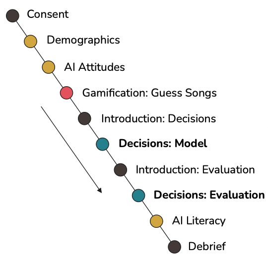{height=450 fig-alt="Survey structure"}
:::
::::

## Example: Exclude Features {#slide-42 .smaller}

<!-- Original PowerPoint slide 42 -->

**What kind of information should an AI system use?** Sometimes AI systems take into account potentially sensitive characteristics […]

[…]

- **Do not exclude any sensitive characteristics:** This means the AI is trained with all available information, including sensitive characteristics like race and sex.
- **Exclude race from the system:** This means the AI uses all information available but not race.
- [ … ]
- I don’t understand the description
- I prefer not to answer
- Suggest an alternative option: __________

## Going Online {#slide-43}

<!-- Original PowerPoint slide 43 -->

:::: {.columns}
::: {.column width="38%"}
- Published on citizen science website
  - themusiclab.org
- N = 375 complete sessions
  - Multiple countries
  - WEIRD bias (especially U.S.)
:::
::: {.column width="62%"}
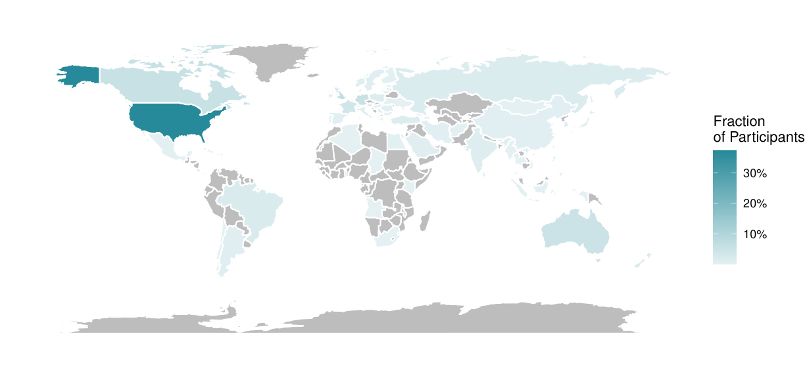{height=330 fig-alt="Geographic distribution of participants"}
:::
::::

## Results {#slide-44 auto-animate=true auto-animate-id="responses" auto-animate-duration="1" auto-animate-easing="ease-in-out"}

<!-- Original PowerPoint slide 44 -->

:::: {.columns}
::: {.column width="52%"}
- Meaningful responses
- High agreement, but also diversity in responses
- A notable number of people skip through the study
:::
::: {.column width="48%"}

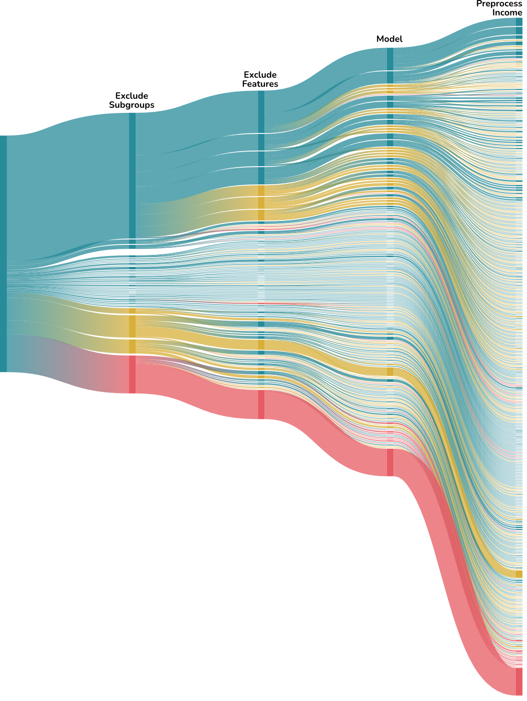

:::
::::

##  {#slide-45 .figure-only auto-animate=true auto-animate-id="responses" auto-animate-duration="1" auto-animate-easing="ease-in-out"}

<!-- Original PowerPoint slide 45 -->

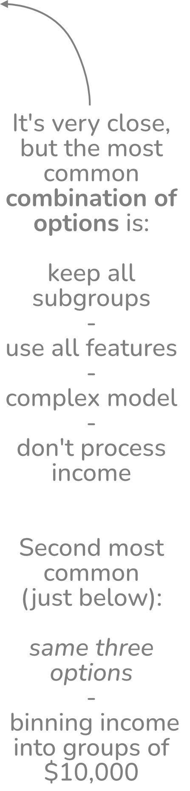

##  {#slide-46 .figure-only auto-animate=true auto-animate-id="responses" auto-animate-duration="1.5" auto-animate-easing="ease-in-out"}

<!-- Original PowerPoint slide 46 -->

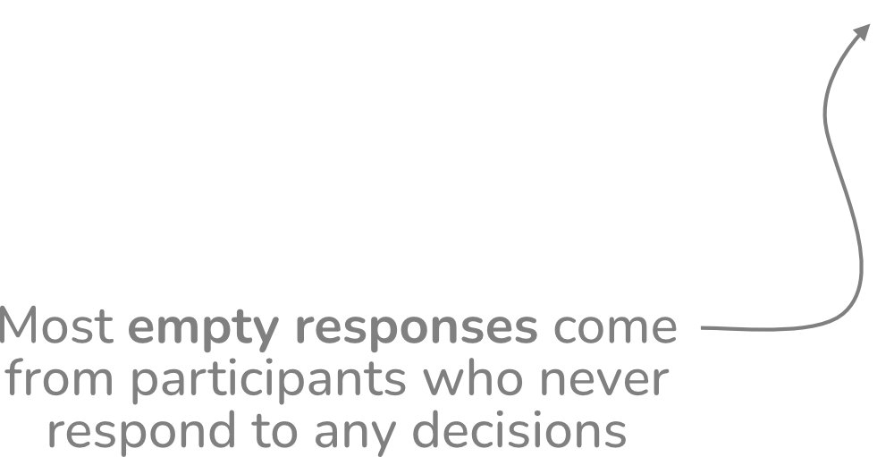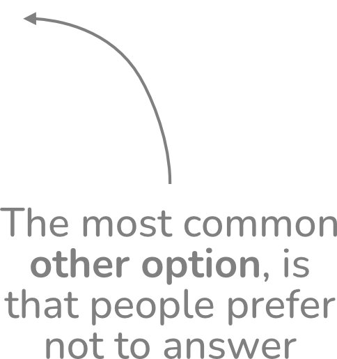

## Different People Make Different Choices {#slide-47}

<!-- Original PowerPoint slide 47 -->

- Responses differ between different groups
  - Higher rate of inclusion for one’s own subgroup
  - More likely to suggest alternatives by those with high AI literacy

::: {.fragment .appear data-fragment-index="0"}
- Compared only a small subset of possible comparisons
:::

::: {.fragment .appear data-fragment-index="0"}
- **→ Importance of diverse sample**
:::

## Participatory Input Leads to Well-performing Models {#slide-48}

<!-- Original PowerPoint slide 48 -->

::: {.small}
**Full Multiverse**　　　　　　　　　　　　　　　　　**Participatory Multiverse**
:::

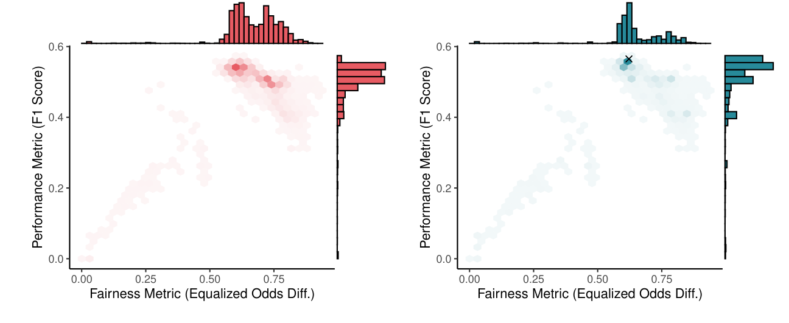{height=425 fig-alt="Performance and fairness of full and participatory multiverses"}

<svg class="annotation-overlay" viewBox="0 0 1157 474"><defs><marker id="arrowhead" markerWidth="8" markerHeight="8" refX="7" refY="4" orient="auto"><path d="M0 0L8 4L0 8" fill="red"/></marker></defs><path class="fragment appear" data-fragment-index="0" d="M 947 146 Q 920 109 865 126" fill="none" stroke="red" stroke-width="2" marker-end="url(#arrowhead)"/><ellipse class="fragment appear" data-fragment-index="1" cx="959" cy="35" rx="105" ry="47" fill="none" stroke="red" stroke-width="2"/></svg>

::: {.small}
Fairness metric: ← Lower is better · Performance metric: Higher is better →
:::

## Key Points {#slide-49}

<!-- Original PowerPoint slide 49 -->

- Non-developers can provide meaningful input on ML design

::: {.fragment .appear data-fragment-index="0"}
- Participatory input can help combat “lazy” data practices and produces reasonable & competitive models
  - (Dis)agreement can be a helpful signal
:::

::: {.fragment .appear data-fragment-index="1"}
- Involving a diverse set of stakeholders matters
:::

## Closing & Outlook {#slide-50 .section-slide}

<!-- Original PowerPoint slide 50 -->

## Closing: Re-Evaluating the ML Pipeline {#slide-51}

<!-- Original PowerPoint slide 51 -->

- Discovered problematic *“lazy” data practices* in the field

::: {.fragment .appear data-fragment-index="0"}
- Saw how fairness metrics can be *hacked* by changing the *evaluation protocol*
:::

::: {.fragment .appear data-fragment-index="1"}
- *(Participatory) multiverse analyses* as potential remedies and powerful methodologies
:::

::: {.pipeline}

| ● | ● | ● | ● | ● | ● |
| :---: | :---: | :---: | :---: | :---: | :---: |
| Data | (Pre-)Processing | Model | Predictions | Decisions | Evaluation |

:::

::: {.notes}
We saw effective techniques of how the machine learning pipeline can be re-evaluated
:::

## Outlook {#slide-52}

<!-- Original PowerPoint slide 52 -->

- Dataset annotations limited in scope → expand scope
  - (Partially) automate annotations

::: {.fragment .appear data-fragment-index="0"}
- Arbitrariness in choice of *plausible* decisions
  - Systematic discovery of decision points
:::

::: {.fragment .appear data-fragment-index="1"}
- “Consultation” in participatory multiverse
  - More empowering forms, e.g., co-design of participatory process
:::

::: {.fragment .appear data-fragment-index="2"}
- Expand into other domains, e.g., text, image
:::

## Thank you! {#slide-53 .section-slide}

<!-- Original PowerPoint slide 53 -->

::: {.pipeline}

| ● | ● | ● | ● | ● | ● |
| :---: | :---: | :---: | :---: | :---: | :---: |
| Data | (Pre-)Processing | Model | Predictions | Decisions | Evaluation |

:::
